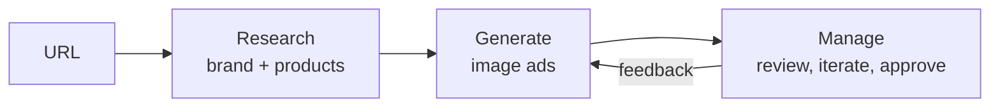
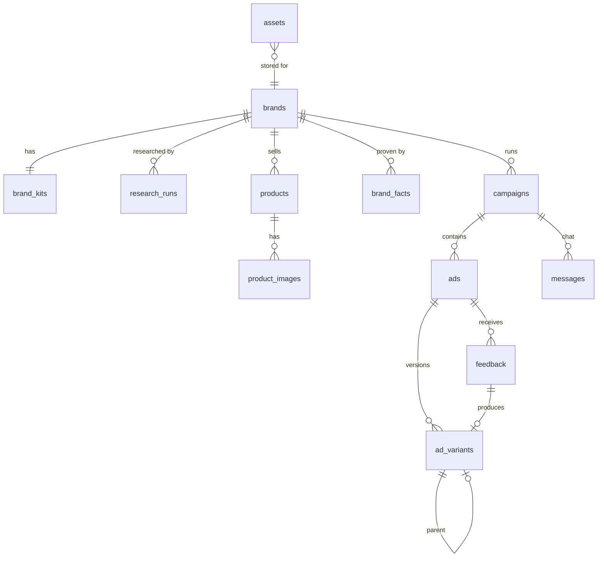

# Coding agent transcript: AI Ads Manager take-home

Session 1508ebd1 (Claude Code, cloud). User messages and Claude replies in full; tool calls summarized one per line; tool outputs omitted.

## User

Can you read this guy https://app.notion.com/p/AI-Ads-Manager-Take-Home-3e0cf884ba2e806f81b7d42da036df1e?source=copy_link

- `ToolSearch`: select:WebFetch
- `WebFetch`: https://app.notion.com/p/AI-Ads-Manager-Take-Home-3e0cf884ba2e806f81b7d42da036df1e?source=copy_link
- `WebFetch`: https://www.notion.so/AI-Ads-Manager-Take-Home-3e0cf884ba2e806f81b7d42da036df1e
- `Bash`: Show repo contents and recent commits
- `mcp__claude-code-remote__read_documentation`: {"topic": "environment.network", "situation": "blocked"}

**Claude:** I couldn't open the page. This session's network settings block Notion: both `app.notion.com` and `www.notion.so` failed to load. The repo (`ploy-takehome`) is also empty, so there's no copy of the brief here either.

To fix it, choose one:

1. **Allow Notion in the environment's network settings.** Open the cloud environment menu in the session's title bar, choose **Edit**, then **Network access**. Add `app.notion.com` and `www.notion.so` under **Allowed domains**, or pick a broader access level. Leave **Allow package managers** ticked. The steps are at https://code.claude.com/docs/en/cloud-environments#network-access. Tell me when that's done and I'll fetch the page again.
2. **Paste the page text** into the chat.
3. **Export the page** to Markdown or PDF and upload it, or commit it to the repo.

Once I have the brief, I can sum up the requirements and help you plan and build the AI Ads Manager take-home.


## User

Did you try any of Notion now?

- `ToolSearch`: notion

## User

[Request interrupted by user]


## User

You can try again. You have Notion now.

- `ToolSearch`: select:mcp__Notion__notion-fetch
- `mcp__Notion__notion-fetch`: {"id": "3e0cf884ba2e806f81b7d42da036df1e"}
- `mcp__Notion__notion-fetch`: {"id": "https://app.notion.com/p/AI-Ads-Manager-Take-Home-3e0cf884ba2e806f81b7d42da036df1e"}
- `ToolSearch`: select:mcp__Notion__notion-search
- `mcp__Notion__notion-search`: AI Ads Manager Take Home

**Claude:** Yes, I tried with the Notion connector, and it still can't open the page:

- **Fetching the link** returned `object_not_found` (404). The connector can't see that page.
- **Searching your workspace** for "AI Ads Manager Take Home" found nothing related. The closest hits were old interview notes.

So the page isn't in the Notion workspace the connector is signed into. It was most likely shared from the company's own workspace, and the connector only reaches yours.

To fix it, choose one:

1. **Duplicate it into your workspace.** Open the page, use the `•••` menu, choose **Duplicate**, and put the copy in your own workspace. Send me the new link or just tell me it's there, and I'll fetch it.
2. **Paste the page text** into the chat.


## User

Build a slice of an AI ads manager that could live inside AppLovin: an ecommerce brand with products but no ads gives its store URL and ends with a set of ad creatives they can review, iterate on, and approve.

## Context

You are on a team inside AppLovin building a new advertiser feature. The user is a marketer at an ecommerce brand that has a store and product photos but no ad creatives yet. Use www.loopycases.com as the example store while you build. The product takes them from a URL to ads they would actually run.

We are testing product judgment, attention to detail, the ability to build autonomously, and business thinking. Working software that feels good matters more than breadth.

You own the product decisions. Where this brief is silent, decide, and explain why in your note.

## What to build

The core loop is research, generate, manage. Make it as agentic as you can: the agent does the work and the user steers.



1. **Onboard.** The user gives a company or product URL. The agent researches the brand (logo, colors, voice, value prop, audience) and pulls real product images and details from the store. Decide what you scrape, what you infer, and what you ask the user. Limiting it to Shopify stores is fine if that makes research easier; say so in your note.
2. **Generate.** Produce full-screen portrait image ads (9:16, portrait interstitials) built around the store's real product photos, never an invented product, with the headline and call to action rendered inside the image.
3. **Manage.** Persist the brand kit, campaigns, ads, variants, assets, and their status in Supabase. The user can give feedback, edit, regenerate, and approve.
4. **Human in the loop.** At least one point where the agent pauses for user input, and one where user feedback changes the next generation.

## Stack

The stack is fixed so we compare like with like. Product and architecture decisions inside it are yours.

| Layer | Use | Notes |
| --- | --- | --- |
| Framework | Next.js (App Router), React, Tailwind |  |
| Agent and chat UI | Vercel AI SDK + AI Elements | Streaming, tool calls, generative UI |
| Data, auth, files | Supabase (Postgres, Auth, Storage) | Auth is optional; a single demo user is fine |
| Image generation | fal.ai | Pick a model that takes a product photo as a reference and renders text well. Copy outputs into Supabase Storage; fal URLs are not durable |
| Research | Firecrawl (Brand Extractor) or a web search API (Exa, Tavily, Brave) |  |
| LLM | Any provider (Vercel AI Gateway recommended) |  |
| Hosting | Vercel |  |

## Deliverables and time box

Budget between 4-6 hours over one week.

Use AI coding tools freely, but stay in the loop. You need to explain every part of how it works, from how product images come off a store to how a finished ad lands in Storage. In the review we pick parts at random and ask how they work; an agent solving a problem for you that you cannot explain counts against you, not for you.

- GitHub repo link.
- Deployed URL on Vercel.
- Key decisions (written by you, not AI) made across product, UX, and system design.
- An architecture diagram drawn by you in Excalidraw, showing how the pieces fit: research, generation, storage, and the UI. Share the link or a PNG export.
- A Loom walkthrough in two parts. First, results from at least five ecommerce sites of your choice; pick sites that stress different things, like product photography, brand voice, and catalog size. Second, how you built it: how you worked with your coding agent, what you asked it to do, where you overrode it, and what you had to figure out yourself.
- Transcripts from your coding agent session(s)

## How we evaluate

We score the deployed app first and the code second.

| Area | What great looks like |
| --- | --- |
| Product judgment | Sensible scrape vs infer vs ask; a good empty state; tool failures degrade gracefully instead of dead-ending |
| Attention to detail | Polished UI, legible on-image text, the product looks like the real one, images stored and served correctly, no loose ends |
| Autonomy and completeness | What you chose to build works end to end on the deployed URL |
| Engineering quality | Clear data model, sane server/client split, streaming done right |
| Creativity and business thinking | The open-ended feature and the reasoning in your note |

We’ll follow up with a 45 minute overview conversation. You walk us through the build, then we talk about improving it, shipping it to production, and what you would measure first.


**Claude:** I'll start by checking what the environment offers: tooling, network reach, and which API keys exist.

- `Bash`: Inspect repo, tooling versions, and available API key env vars
- `Bash`: Check proxy status and reachability of needed hosts
- `ToolSearch`: select:mcp__Supabase__list_organizations,mcp__Supabase__list_projects,mcp__Vercel__list_teams,mcp__Vercel__list_projects,mcp__Vercel__get_auth_user
- `mcp__Supabase__list_organizations`: {}
- `mcp__Supabase__list_projects`: {}
- `mcp__Vercel__list_teams`: {}

## User

[Request interrupted by user]


## User

let's not worry about the specific connectors right now. Let's focus on the problem core. What problem are we trying to solve?


**Claude:** Here's how I'd frame it.

## The problem

**An ecommerce brand wants to buy AppLovin inventory but has nothing to run.** AppLovin opened its ad platform (Axon) to ecommerce advertisers recently. Those brands have a store, product photos and maybe some Instagram content. They have nothing built for where AppLovin ads actually show up: a full-screen, portrait ad that appears between levels of a mobile game.

That placement is unusual, and it's why existing assets don't work:

- **The audience is cold and interrupted.** The person is playing a game. They didn't search for phone cases and don't know the brand. The ad has about two seconds to say what the product is, why they'd want it, and what to tap.
- **It's portrait and full-screen.** A square product shot on white wastes the screen. Meta ads were built for a feed people scroll through on purpose, so they don't carry over directly either.
- **Creative is the main thing that decides performance.** Targeting is mostly automated. Creative is what the advertiser still controls, and the system learns faster when it has several variants to test.

So the real blocker is creative. Without it, a marketer who signs up never launches a campaign, and AppLovin earns nothing from them.

## Two views of the same problem

**The marketer** (often a one- or two-person growth team at a Shopify brand) wants to get from "here's my store" to "ads I'd trust to run" in minutes, without a designer or agency, and without risking the brand.

**AppLovin** wants new advertisers to start spending. Every advertiser who gets stuck at the creative step is lost. That makes this feature a way to turn sign-ups into paying advertisers, not an image generator for its own sake.

## What makes it hard

The hard part isn't producing images. It's producing ads the marketer will approve:

1. **The product has to be the real one.** An AI-invented phone case is worse than no ad: it hurts the brand and amounts to false advertising. Real product photos have to anchor every ad.
2. **The text has to be legible and correct.** A misspelled headline baked into the image means the ad can't run.
3. **The ads have to sound like the brand.** Generic stock-ad copy won't get approved.
4. **The marketer needs to stay in control.** They want the agent to do the work, but it's their brand, so they need clear points where they can steer and approve.

## What "solved" looks like

A marketer pastes their URL and, within a few minutes, approves a handful of ads they'd actually run, having changed the direction along the way. Here's what I'd measure, roughly in priority order:

- **Share of onboarded brands that approve at least N ads.** This is the activation number.
- **Time from pasting the URL to the first approval.**
- **How often ads get regenerated or edited before approval.** This shows quality and where it falls short.
- **Later: how the ads perform once live** (click-through rate and return on ad spend). That's what ultimately matters, though it's out of scope for this slice.

## What this slice should leave out

Launching campaigns, bidding and budgets, video and playable ads (a large share of AppLovin inventory, but a separate problem), and multiple users per account. Only static 9:16 images are in scope.

---

A few product decisions follow from this framing. You should make these yourself, since the brief wants the key-decisions note written by you:

- **Where the agent should stop and ask.** My instinct: confirm the brand kit and pick which products to feature before generating anything. A wrong brand read makes every later ad wrong, and this check costs the marketer about ten seconds.
- **How many ads to generate first.** I'd start with something like three or four distinct angles (for example lifestyle, benefit-led and social proof). That gives the marketer a real choice without burying them, and their feedback narrows the next round.
- **Whether to support only Shopify stores.** I believe Loopy Cases runs on Shopify. Shopify exposes product data in a predictable way, which makes pulling real product photos reliable. For this slice I think that trade-off is worth it.

Do you want to work through these decisions next, or move on to how the agent loop should be structured?


## User

Yeah, so I think the first thing that we need to establish for this is the quality bar that we expect from the agent. So yeah, let's first think about what questions we need to curate from them. So let's say it's a Shopify. We have the product images. Let's first set up by figuring out our pre-agentic flow where we ask them the questions about like what we should highlight, what, I don't know, marketing stuff.


**Claude:** Good place to start. Every answer in this flow becomes an input the agent's ads are judged against, so the questions are part of the quality bar.

## Principle: only ask what we can't get any other way

Each candidate piece of information goes into one of three buckets:

| Bucket | Rule | User effort |
|---|---|---|
| **Scrape** | Facts that are on the store | None |
| **Infer, then confirm** | Judgments the agent can make from the store | One click to accept or edit |
| **Ask** | Things only the marketer knows that change the ad | Short answer, with a suggested default |

So questions come **after** research, never before. Apart from the URL, the marketer should never see a blank field. They see the agent's best guess and correct it. The whole flow should take about 60 seconds.

## Scraped (Shopify makes this reliable)

- **Products:** title, description, images, price, sale price, variants, tags, collections. All of these come from Shopify's public `/products.json`.
- **Best sellers:** the `/collections/all?sort_by=best-selling` page gives a real popularity signal for free.
- **Brand assets:** logo, colors and fonts, from the theme and homepage.
- **Live promotions:** the announcement bar ("Free shipping over $50", "20% off sitewide").
- **Social proof:** review counts and ratings if a reviews app such as Judge.me, Okendo or Yotpo is embedded.

## Inferred, then confirmed

- **Brand voice:** a few adjectives plus an example line.
- **Value proposition:** the one reason people buy.
- **Selling points:** candidate angles pulled from product copy and reviews.
- **Audience:** who it's for. This shapes tone, not targeting. AppLovin's Axon handles targeting itself, and the viewer is someone playing a game.

## Must ask: the questions themselves

I'd keep it to five, each pre-filled:

1. **Which products should we feature?**
   Best sellers come pre-selected; the user picks 1–3. This matters most for quality: it decides which real photos anchor the ads.

2. **What should we lead with?**
   Multi-select chips built from the inferred selling points (for example "Protective", "Cute designs", "Customizable", "Fits MagSafe"), plus a free-text option. Each selected angle becomes a distinct ad concept.

3. **Is there an offer we can advertise?**
   Pre-filled from the announcement bar, with "No offer" as an option. This one is a hard rule: **the agent never invents a discount**. An ad promising 20% off that the store doesn't honor is a compliance problem, not just a quality one.

4. **Does this sound like you?**
   Shows the inferred voice and value proposition, editable. This is the main brand check: if the read is wrong here, every ad will be wrong.

5. **Anything to avoid?** (optional)
   Claims, words or imagery that are off-limits, such as "don't say *indestructible*" or "no competitor phone brands". Few people fill it in, but the ones who do care a lot.

### Deliberately not asked

Aspect ratio, number of ads, fonts, exact color values, CTA wording (we default to "Shop Now" and the user can edit it on an individual ad later), budget and targeting. Each of these either has a good default or is out of scope. Asking would put work on the user that the agent should be doing.

## What this produces: the creative brief

The answers become one structured object. The agent generates from it and is checked against it:

```ts
type CreativeBrief = {
  products: ProductRef[]          // 1–3, each with real image URLs
  angles: string[]                // each one becomes an ad concept
  offer: string | null            // null means the ad never mentions price or discount
  voice: { adjectives: string[]; example: string }
  valueProp: string
  avoid: string[]
  brandKit: { logoUrl: string; colors: string[]; font?: string }
}
```

## How the brief becomes the quality bar

Every generated ad has to pass checks that trace back to the brief:

- **Right product:** the product is recognizably the one in the reference photo, not a lookalike. *(Q1)*
- **On angle:** the ad makes one clear claim, from the chosen angles. *(Q2)*
- **Honest offer:** an offer appears only if one was confirmed, and word for word. *(Q3)*
- **On voice:** the copy matches the confirmed voice. *(Q4)*
- **Guardrails respected:** nothing from the avoid list appears. *(Q5)*
- **Correct, legible text:** the headline and CTA match the approved copy exactly, with enough contrast to read.
- **Safe zones:** no text in the top ~10%, where the close button sits on an interstitial, or at the very bottom edge.

This also gives a clean split between two pause points. The brief confirmation is the first human checkpoint. Approving individual ads is the second, and the feedback given there edits the brief (for example dropping an angle or tightening the voice), so the next generation changes in ways the marketer can see.

## Decisions for you

1. **Should the offer question exist at all for the first version?** Without it, the agent can't use "% off" angles. With it, it needs a firm never-invent rule. I lean towards keeping it, since offers perform well on cold traffic.
2. **Should we show 1–3 products, or let the user pick a whole collection?** Fewer products makes each ad better; more covers the catalog.
3. **Should we drop the audience confirmation?** Because targeting is automatic, it only changes tone, and question 4 may already cover that.

Once these are settled, the next step is the research agent: what it scrapes, in what order, and what it falls back on when a store doesn't cooperate.


## User

yeah, let's just do your recommendation. And then for number 2 and 3, I guess my question is, if we have to ask the user to put in the products, that seems like a bit of an overhead, right? It should just take the shop and then just come up with ads.


**Claude:** Agreed. Picking products is a judgment the agent can make, so making the marketer do it is overhead. I'll move products, and the angles, from "ask" to "the agent decides, the user can override". That leaves almost nothing the user has to do.

## Revised flow: one confirmation instead of a form

```
URL → agent researches (shows progress live) → brief card, fully pre-filled → [Generate] → ads
```

The brief card is still the first pause point, but nothing on it requires input. The marketer reads it and clicks **Generate**, or changes something first. Keeping the pause is worth it: it costs about 5 seconds and catches a wrong brand read *before* we spend money and minutes generating images.

## How the agent picks products

1. **Best sellers first,** using Shopify's best-selling sort order.
2. **In stock only.** At least one variant must be available, since there's no point advertising something that's sold out.
3. **Usable photo.** High enough resolution, with the product clearly visible. Skip size charts, close-ups of packaging and tiny thumbnails.
4. **Visual variety.** Avoid three near-identical cases in different colors; pick products that look different from each other.
5. **Pick 3,** and show a one-line reason for each on the card (for example "#1 best seller", "Shows the custom-print range").

The marketer can still swap a product, which covers what the store data can't show, such as a new launch or overstock they want to push. But they never *have* to.

## Updated buckets

| What | Bucket | Default if the user does nothing |
|---|---|---|
| Products (3) | Agent decides | Best sellers that are in stock, varied, with good photos |
| Angles | Agent decides | One distinct angle per ad, from the selling points it found |
| Voice and value proposition | Inferred, shown for confirmation | The agent's read of the store |
| Audience | **Removed** | Folded into voice; Axon handles targeting |
| Offer | Asked, pre-filled | The announcement-bar promotion if one exists, otherwise **no offer** |
| Things to avoid | Optional | Empty |

So the only real question left is the offer, and even that has a safe default. **Doing nothing is never wrong; at worst the result is generic,** which the feedback loop then fixes.

## Where this leaves the quality bar

It doesn't change. The checks still trace back to the brief; the agent simply fills in more of the brief itself. One addition: since the agent now picks the products, **a bad product choice counts as an agent failure, not a user failure**. That's why the reason line on each pick matters. It makes the agent's judgment visible and easy to check.

Next is the research agent itself: what it fetches from a Shopify store and in what order, how it gets the logo and colors, and what it does when something fails (no best-selling sort, products that won't load, a store that isn't Shopify). Want to go there?


## User

Yeah, let's dive into that and start investigating the happy path and the fallback behaviors.

- `WebFetch`: https://www.loopycases.com/products.json?limit=5

**Claude:** I tried to look at Loopy Cases directly and couldn't: this session's network blocks `www.loopycases.com`, along with every other non-package host. So what follows comes from how Shopify stores behave in general, not from checking this store. I've marked which claims still need checking against real stores before we rely on them.

## Happy path (Shopify store)

Each step is independent, and the steps can run in parallel:

| # | What | Where it comes from | What we get |
|---|---|---|---|
| 0 | **Clean up the URL** | Input | Add https and reduce to the domain. If they pasted a product URL, that product is always included. |
| 1 | **Detect Shopify** | Homepage HTML | Look for `cdn.shopify.com` and `window.Shopify` in the page, plus Shopify response headers. This works on custom domains too. |
| 2 | **Store info** | `/meta.json` ⚠️ | Store name, description, currency, product count |
| 3 | **Catalog** | `/products.json?limit=250&page=N` | Title, description, tags, product type, variants (price, sale price, in stock), images (URL, width, height, alt text). Stop at about 2 pages. |
| 4 | **Best sellers** | `/collections/all?sort_by=best-selling` ⚠️ | Product handles in sales order, read from the page's links |
| 5 | **Brand kit** | Firecrawl brand extraction, with homepage HTML as backup | Logo, colors, fonts. Backup sources: the theme's CSS color variables, the header logo image, favicon and `og:` tags. |
| 6 | **Promotions and voice material** | Homepage announcement bar, `/pages/about` | Current offer; the brand's own description of itself |
| 7 | **Social proof** | Product pages for the top 3 products | Ratings and review counts from the page's structured product data or the reviews app widget |
| 8 | **Synthesis** (LLM) | The structured bundle from steps 1–7 | Voice, value proposition, selling points, 3 product picks with reasons, one angle per pick |

Rationale for the split: **Shopify's own data covers facts** (it's free, structured, and gives real image URLs), **Firecrawl covers the look of the brand**, where themes vary too much to parse by hand, and **the LLM only does judgment**. The LLM never produces a product or an image URL; it can only refer to products by their store handle.

Two image details:

- Shopify's image CDN resizes on request (add `width=` to the URL), so we fetch reference images at a known size.
- The chosen reference images are copied into Supabase Storage, so the brand kit doesn't depend on the store's URLs staying the same.

## Fallbacks

The rule is that **research never fails as a whole**. It returns a partial brief, and every field is labeled as *scraped*, *inferred* or *missing*. The brief card shows those labels, so anything missing is visibly something to fill in rather than an error.

| Failure | Detected by | Fallback |
|---|---|---|
| **Not a Shopify store** | No Shopify markers; `/products.json` returns 404 | Use Firecrawl to read the site's structured product data (most ecommerce platforms publish it). If that also fails: "Paste a product link or upload photos." |
| **Password-protected store** | Redirect to `/password` | Explain that the store is locked and offer product links or photo upload |
| **Blocked or rate-limited** | 403 or 429, Cloudflare challenge pages | One retry with backoff, then fetch through Firecrawl |
| **No best-selling order** | Empty or missing sort | Use the order of products featured on the homepage, then a simple score (on sale, number of images, how recently updated) |
| **Huge catalog** | Product count above ~500 | Stop paging; the best-seller list already narrows the choice |
| **Only 1–2 products** | Small catalog | Use different angles on the same product instead of different products |
| **Everything sold out** | No variant in stock | Pick anyway, with a warning on the card |
| **Unusable photos** | Under ~800px, or file name or alt text suggesting a size chart or packaging | Skip that image; try the product's other images; if none work, flag the product |
| **No logo found** | Nothing from Firecrawl, the header or the favicon | Use the store name as a text wordmark and show "Upload your logo" |
| **White logo on a transparent background** | Brightness check | Place it on a dark background in ads; show it on dark in the card |
| **No brand colors** | Nothing from Firecrawl or the CSS | Take the main colors from the logo, then from product photos |
| **LLM synthesis fails** | Error or invalid output | Use the store's meta description and the top products, without reasons; every field stays editable |
| **Slow step** | A time limit on each step | Continue without it and mark that field as missing |

## Not yet checked (⚠️)

1. Whether `/meta.json` is still public on current Shopify stores.
2. Whether `/collections/all?sort_by=best-selling` gives a usable order, and whether `/collections/all/products.json` accepts `sort_by` (that would avoid parsing HTML).
3. What Firecrawl's brand extraction returns for Shopify themes: how often it finds the right logo and colors.
4. Whether `/products.json` still pages with `page=`, or limits how far you can page.

These are the assumptions everything else rests on, so I'd check them on 4–5 real stores before writing the research code: Loopy Cases plus a few chosen to stress different things, such as a big catalog, a minimal brand, and a store that isn't on Shopify.

To run those checks I need network access to those sites. You can add `loopycases.com` (or wildcard `*.myshopify.com` plus the specific stores) to Allowed domains in this environment's network settings, or switch to a broader access level. Alternatively I can run the checks from a Vercel Sandbox on your account, which has its own internet access.

Which do you prefer? Once the checks run, I'll report what they show and adjust this plan before building.


## User

Yeah, let's run the checks right now.

- `Bash`: Recheck whether store and Firecrawl hosts are reachable
- `ToolSearch`: vercel sandbox create run command

**Claude:** The network here is still blocked, so I'll run the checks from a Vercel Sandbox. First I need to find a project on your account to run it under.

- `mcp__Vercel__list_projects`: {"teamId": "team_o22D5frj0jMxr7vh3lYETZlu", "limit": "20"}
- `mcp__Vercel__list_projects`: {"teamId": "team_JKuJLkyZ6ITxVCwWJ1SXtI28", "limit": "20"}

**Claude:** No existing project fits, so I'll create a `ploy-takehome` project in your `qrtz` team. It's where the app will be deployed later anyway, and the sandbox will run under it.

- `ToolSearch`: select:mcp__Vercel__create_project,mcp__Vercel__get_session_command_logs,mcp__Vercel__write_session_files,mcp__Vercel__stop_session,mcp__Vercel__get_session
- `mcp__Vercel__create_project`: {"teamId": "team_o22D5frj0jMxr7vh3lYETZlu", "requestBody": {"name": "ploy-takehome", "framework": "nextjs"}}

**Claude:** Project created. Next I'll write the probe script that checks each assumption.

- `Bash`: Write Shopify probe script and package it for upload
- `mcp__Vercel__create_sandboxes_v2`: {"teamId": "team_o22D5frj0jMxr7vh3lYETZlu", "requestBody": {"projectId": "prj_OMybcG0ZKrzH4O4UjJ3uBSJQ3SLK", "region": "iad1", "runtime": "node24", "name": "sho…
- `Bash`: Print base64 tarball for upload
- `mcp__Vercel__write_session_files`: {"teamId": "team_o22D5frj0jMxr7vh3lYETZlu", "sessionId": "sbx_tuDGIV4A9tTqT2iUGQqfQVLMp5LO", "xCwd": "/vercel/sandbox", "requestBody": "<base64…>"}
- `mcp__Vercel__run_session_command`: {"teamId": "team_o22D5frj0jMxr7vh3lYETZlu", "sessionId": "sbx_tuDGIV4A9tTqT2iUGQqfQVLMp5LO", "requestBody": {"command": "node", "args": ["probe.mjs", "www.loopy…
- `mcp__Vercel__get_session_command_logs`: {"teamId": "team_o22D5frj0jMxr7vh3lYETZlu", "sessionId": "sbx_tuDGIV4A9tTqT2iUGQqfQVLMp5LO", "cmdId": "cmd_29462eec1e7943feabb70ee5c7a3"}

**Claude:** The output was cut off, so I'll run one store per command to get each result in full.

- `mcp__Vercel__run_session_command`: {"teamId": "team_o22D5frj0jMxr7vh3lYETZlu", "sessionId": "sbx_tuDGIV4A9tTqT2iUGQqfQVLMp5LO", "requestBody": {"command": "sh", "args": ["-c", "for s in www.loopy…
- `mcp__Vercel__run_session_command`: {"teamId": "team_o22D5frj0jMxr7vh3lYETZlu", "sessionId": "sbx_tuDGIV4A9tTqT2iUGQqfQVLMp5LO", "requestBody": {"command": "sh", "args": ["-c", "node -e \"const t=…
- `mcp__Vercel__get_session_command_logs`: {"teamId": "team_o22D5frj0jMxr7vh3lYETZlu", "sessionId": "sbx_tuDGIV4A9tTqT2iUGQqfQVLMp5LO", "cmdId": "cmd_1f1afc240fbf443f99612d71b69d"}
- `Bash`: Write chunked result printer and package it
- `mcp__Vercel__write_session_files`: {"teamId": "team_o22D5frj0jMxr7vh3lYETZlu", "sessionId": "sbx_tuDGIV4A9tTqT2iUGQqfQVLMp5LO", "xCwd": "/vercel/sandbox", "requestBody": "<base64…>"}
- `mcp__Vercel__run_session_command`: {"teamId": "team_o22D5frj0jMxr7vh3lYETZlu", "sessionId": "sbx_tuDGIV4A9tTqT2iUGQqfQVLMp5LO", "requestBody": {"command": "node", "args": ["show.mjs", "out-www.lo…
- `mcp__Vercel__get_session_command_logs`: {"teamId": "team_o22D5frj0jMxr7vh3lYETZlu", "sessionId": "sbx_tuDGIV4A9tTqT2iUGQqfQVLMp5LO", "cmdId": "cmd_f30ae929d41b4274808108053e94"}

**Claude:** Loopy Cases is done and has already disproved one assumption: almost all of its product photos are only 720px wide. I'm reading the remaining results now.

- `mcp__Vercel__run_session_command`: {"teamId": "team_o22D5frj0jMxr7vh3lYETZlu", "sessionId": "sbx_tuDGIV4A9tTqT2iUGQqfQVLMp5LO", "requestBody": {"command": "node", "args": ["show.mjs", "out-www.lo…
- `mcp__Vercel__get_session_command_logs`: {"teamId": "team_o22D5frj0jMxr7vh3lYETZlu", "sessionId": "sbx_tuDGIV4A9tTqT2iUGQqfQVLMp5LO", "cmdId": "cmd_8dd4fbc229fe4bcfa2c28e4ba90f"}
- `mcp__Vercel__run_session_command`: {"teamId": "team_o22D5frj0jMxr7vh3lYETZlu", "sessionId": "sbx_tuDGIV4A9tTqT2iUGQqfQVLMp5LO", "requestBody": {"command": "node", "-args": [], "args": ["-e", "con…
- `mcp__Vercel__run_session_command`: {"teamId": "team_o22D5frj0jMxr7vh3lYETZlu", "sessionId": "sbx_tuDGIV4A9tTqT2iUGQqfQVLMp5LO", "requestBody": {"command": "node", "args": ["-e", "const fs=require…
- `mcp__Vercel__get_session_command_logs`: {"teamId": "team_o22D5frj0jMxr7vh3lYETZlu", "sessionId": "sbx_tuDGIV4A9tTqT2iUGQqfQVLMp5LO", "cmdId": "cmd_4a17665d0f184de18034811f928c"}
- `mcp__Vercel__stop_session`: {"teamId": "team_o22D5frj0jMxr7vh3lYETZlu", "sessionId": "sbx_tuDGIV4A9tTqT2iUGQqfQVLMp5LO"}

**Claude:** I ran the checks against six stores from a Vercel Sandbox. Several of my assumptions were wrong, and the misses change the design.

| Store | What it stresses | Result |
|---|---|---|
| **Loopy Cases** | Reference store | ✅ Everything worked: 230 products, best-seller order, ratings |
| **Allbirds** | Large catalog, high-quality photos | ✅ Mostly: 360 products over 2 pages; best-seller order not readable |
| **Liquid Death** | Strong brand voice | ✅ 217 products, best-seller order works |
| **Gymshark** | Very large catalog | ❌ Store runs on Shopify behind a custom front end; product data returns 403 |
| **Ridge** | Minimal brand | ❌ Bot protection returned 403 on every request, including the homepage |
| **Nike** | Not Shopify | ❌ No Shopify data, as expected |

## What held up

- **`/meta.json` works.** On every store that let us in it returned the product count, currency and name, and the counts matched the catalog exactly.
- **`/products.json` pages correctly.** Allbirds came back as 250 + 110 = 360 products, and pages past the end return empty without an error.
- **Ratings are usually published as structured data.** Loopy's top product shows 4.9 from 404 reviews, collected by its reviews app (Okendo). Allbirds has them too; Liquid Death doesn't.

## What was wrong

1. **The JSON endpoint ignores the best-seller sort on all three open stores.** The order has to be read from the collection page's links. That worked on Loopy and Liquid Death but found nothing on Allbirds, whose product grid loads after the page, in the browser.
2. **My 800px image cutoff would have rejected Loopy's entire catalog.** 6,278 of its 6,307 photos are 720×960, while Allbirds' are around 4000px. The cutoff has to be about 600px, and Shopify's CDN can't enlarge an image beyond its original size.
3. **Best sellers aren't always the main product.** Loopy's top two sellers are finger loops sold separately (`solid-super-loops`, `art-print-super-loops`), and a screen protector ranks fourth. Picking strictly by sales would make the first ad about an accessory. The picker should favor the store's main product type (`cases` here) and push accessories down.
4. **Reading brand details from raw HTML is unreliable:**
   - Logos: Loopy uses an ``, Liquid Death an inline SVG, and on Allbirds my check found none at all.
   - Colors: only Loopy exposed CSS color variables (primary `#166534`), and they use custom names rather than Shopify's default theme naming.
   - Promotions: my announcement-bar check picked up a shopping-cart widget instead. A wrong offer is the worst possible error here, so this approach is out.

   That makes Firecrawl's brand extraction the main source rather than a backup.
5. **Homepages are 0.7–4.6 MB of HTML.** Raw HTML can never go to the LLM; we extract structured facts first.
6. **About pages are inconsistent.** Allbirds uses `/pages/about-us`; Loopy and Liquid Death have neither. Voice should come from the meta description and product copy. Loopy's description already contains "70,000+ five star reviews" and "lifetime warranty".

## The production lesson

The sandbox fetched from a datacenter IP address, and Vercel functions do too. So the 403s from Gymshark and Ridge will happen in production, not just in testing. **2 of the 5 Shopify-based stores block direct fetching.** That makes the Firecrawl fallback necessary for products as well, not just for the brand kit.

## Revised research plan

| Need | First choice | Fallback 1 | Fallback 2 |
|---|---|---|---|
| Products | `/products.json` | Firecrawl: product pages' structured data | "Paste product links or upload photos" |
| Best sellers | Links on the best-selling collection page | Order of products on the homepage (this works on Loopy) | Score: on sale, image count, recency |
| Hero products | Prefer the main product type; push accessories down | LLM judgment | — |
| Reference image | Featured image, at least 600px | Next-best image of that product | Flag the product |
| Brand kit | Firecrawl brand extraction | `og:` tags, theme color, logo `` or SVG | Store name as a text wordmark |
| Offer | **Never scraped automatically** | — | — |
| Voice | Meta description, product copy | Firecrawl page text | — |

The offer change matters: the brief card now always starts with **"No offer"**, and the marketer types one in if they have one. Since false offers are the error we can't afford, it's better to ask than to scrape.

## Still not checked

Firecrawl itself. I don't have a key, so I don't yet know how good its brand extraction is, or whether it gets past Ridge's and Gymshark's bot protection. That's the most important open question, since Firecrawl now covers both the brand kit and two blocked stores.

## Resources created

- A Vercel project, **`ploy-takehome`**, in your `qrtz` team. The app will deploy there later.
- One sandbox run, about 6 minutes. It's stopped now.
- The probe script is saved at `/tmp/claude-0/-home-user-ploy-takehome/1508ebd1-96bb-586d-aef5-5c36987728c6/scratchpad/probe/probe.mjs` so we can rerun it.

**Next step:** to test Firecrawl on the same stores I need a Firecrawl API key. The free tier is enough for this. Add it as a sensitive environment variable on the `ploy-takehome` Vercel project, not in chat, and I'll pass it to the next sandbox run. Want to do that, or move on to designing the generation step first?


## User

Yeah, let's do everything we can without the fire crawl. Yeah, I'm out of laptop, so let's do a generation stuff now.


**Claude:** While you're away from your laptop, I'll design the generation step and prototype the part that needs no API keys.

- `Bash`: Check if Shopify CDN and font hosts are reachable locally
- `ToolSearch`: select:mcp__Vercel__read_session_file
- `mcp__Vercel__create_sandboxes_v2`: {"teamId": "team_o22D5frj0jMxr7vh3lYETZlu", "requestBody": {"projectId": "prj_OMybcG0ZKrzH4O4UjJ3uBSJQ3SLK", "region": "iad1", "runtime": "node24", "name": "gen…
- `mcp__Vercel__run_session_command`: {"teamId": "team_o22D5frj0jMxr7vh3lYETZlu", "sessionId": "sbx_1kUXhNjEPnQyGgwvfjpRiwXIHF5J", "requestBody": {"command": "sh", "args": ["-c", "mkdir -p img && cd…
- `mcp__Vercel__get_session_command_logs`: {"teamId": "team_o22D5frj0jMxr7vh3lYETZlu", "sessionId": "sbx_1kUXhNjEPnQyGgwvfjpRiwXIHF5J", "cmdId": "cmd_d24630124a074d47a0572994a3a1"}
- `mcp__Vercel__run_session_command`: {"teamId": "team_o22D5frj0jMxr7vh3lYETZlu", "sessionId": "sbx_1kUXhNjEPnQyGgwvfjpRiwXIHF5J", "requestBody": {"command": "sh", "args": ["-c", "cd img && node -e …
- `mcp__Vercel__read_session_file`: {"teamId": "team_o22D5frj0jMxr7vh3lYETZlu", "sessionId": "sbx_1kUXhNjEPnQyGgwvfjpRiwXIHF5J", "requestBody": {"path": "/vercel/sandbox/img/logo.png"}}
- `mcp__Vercel__stop_session`: {"teamId": "team_o22D5frj0jMxr7vh3lYETZlu", "sessionId": "sbx_1kUXhNjEPnQyGgwvfjpRiwXIHF5J"}
- `Bash`: Install render prototype deps and stand-in photo source
- `Write`: /tmp/claude-0/-home-user-ploy-takehome/1508ebd1-96bb-586d-aef5-5c36987728c6/scratchpad/render/render.mjs
- `Bash`: Render four prototype ads with the type layer

**Claude:** Rendered. Let me look at them.

- `Bash`: Build a contact sheet of the four renders
- `Read`: /tmp/claude-0/-home-user-ploy-takehome/1508ebd1-96bb-586d-aef5-5c36987728c6/scratchpad/render/contact.jpg
- `Read`: /tmp/claude-0/-home-user-ploy-takehome/1508ebd1-96bb-586d-aef5-5c36987728c6/scratchpad/render/render.mjs
- `Bash`: Add detail-based panel mode and wrapping fixes, re-render

**Claude:** The panel switched on for all four, so the threshold is too low. Let me look at the detail values to calibrate it.

- `Bash`: Print detail scores per render
- `Bash`: Compute Laplacian detail manually and re-render
- `Bash`: Replace legibility logic with worst-pixel contrast solver
- `Bash`: Tighten worst-pixel percentile and re-render contact sheet
- `Read`: /tmp/claude-0/-home-user-ploy-takehome/1508ebd1-96bb-586d-aef5-5c36987728c6/scratchpad/render/contact.jpg
- `Bash`: Try word-joiner hyphen fix and light-text bias, re-render
- `Read`: /tmp/claude-0/-home-user-ploy-takehome/1508ebd1-96bb-586d-aef5-5c36987728c6/scratchpad/render/contact2.jpg

**Claude:** Both problems are fixed. I'll make a final contact sheet to send you.

- `Bash`: Build final contact sheet for the user
- `SendUserFile`: {"files": ["/tmp/claude-0/-home-user-ploy-takehome/1508ebd1-96bb-586d-aef5-5c36987728c6/scratchpad/render/type-layer-prototype.jpg"], "caption": "Prototype text…

**Claude:** I've designed the generation step and built a working prototype of the part that needs no API keys. The image I sent shows its output. The prototype runs only against stock photos, since there's no fal.ai key yet, so nothing has generated an image.

## Recommendation: build each ad in two layers

```
product photo ─▶ [1. Scene: fal.ai] ─▶ background image ─▶ [2. Text: our code] ─▶ final 1080×1920 image ─▶ Supabase Storage
                                                              headline, CTA, logo, stars
```

**1. Scene layer (fal.ai).** The model produces the picture: the real product in a 9:16 scene, with clean, empty space where the text will go. It draws no text itself.

**2. Text layer (our code).** We draw the headline, button, logo and stars on top, using the brand's own colors, then save one flat image.

This still meets "headline and CTA rendered inside the image", since the final file is a single image with no live text. Doing the text ourselves instead of asking the model for it has three advantages:

- **The copy is always exactly right.** Image models still misspell, and one misspelled headline means the ad can't run.
- **Editing copy is instant and free.** Changing a headline re-runs only the text layer, which takes about a second and needs no new image. Only feedback about the picture costs a generation.
- **Legibility is calculated, not hoped for.** For each ad, the code finds the brightest (or darkest) 5% of pixels behind the text and works out the lightest darkening overlay that still gives 4.5:1 contrast. It also chooses white or dark text. If no reasonable overlay gets there, the text goes on a solid panel.

The trade-off is that text drawn by the model can look more integrated, such as lettering painted onto a surface. The brief does say "pick a model that renders text well", so expect the reviewers to ask about this. That's why it's the first decision below.

## Product fidelity: extend the brand's own photos first

Loopy's photos are 720×960 lifestyle shots, such as "A woman holding a Blonde Tortoise Loopy Case". So the safest scene is **the brand's own photo, extended from 3:4 to 9:16**: the model adds new top and bottom areas around the untouched original. The product pixels stay real, which addresses "the product looks like the real one" as directly as possible. The new bands land exactly where the text goes.

The agent chooses a strategy per product:

| The store has… | Scene strategy |
|---|---|
| Lifestyle photos | **Extend the real photo** (product guaranteed correct) |
| Only plain product shots on white | **Generate a new scene** using the photo as a reference, then run a vision check that the product matches |
| A failed vision check | Retry once, then **cut out the real product and place it** on a generated background |

The image's alt text tells us which kind each photo is ("A woman holding…" versus "The iPhone 16 Pro … Loopy Case").

## Pipeline for each ad

1. **Concept (LLM).** Choose an angle, write the headline (28 characters or fewer) and CTA, pick a layout, and describe the scene. **Every factual claim must point to a scraped fact.** "70,000+ five-star reviews" comes from the store's meta description and "4.9 from 404 reviews" from the product page's ratings data. A check rejects any number without a source.
2. **Scene (fal.ai).** Pass the reference photo plus the layout's reserved text area. **Copy the result to Storage immediately**, because fal's URLs expire.
3. **Quality check (vision LLM).** Is it the same product? Is the text area clear? Did the model sneak in fake text or logos?
4. **Compose.** Draw the text layer, save the final image to Storage, and record it as a new version of the ad.

## Feedback routing: the cheapest change that works

| Feedback | Action | Cost |
|---|---|---|
| "Punchier headline", or a direct text edit | Re-draw the text layer only | About 1 second, free |
| "Show it in someone's hand", "brighter" | New scene, same copy | One generation |
| "We're less formal than this" | Update the brief, and offer to regenerate the other ads | Applies to future ads |

Every change creates a new version and old versions are kept. The user approves one version per ad.

## Prototype findings

- **Average contrast isn't enough to judge legibility.** My first check approved dark text over a background full of text. The worst-case-pixel rule replaced it.
- **Wrapping needed balancing.** Without it, single words ended up alone on a line ("again"). Hyphenated words also needed protecting so they don't break ("drop-/proof").
- **Known weak case (the fourth ad):** text over a patterned or text-filled background. The contrast passes, but the ad looks cluttered. The fix belongs upstream: the scene prompt keeps the text area clean, and the vision check flags clutter.

## Decisions for you

1. **Text drawn by our code versus by the model.** I recommend our code, for the guarantees above. A middle option is to also offer model-drawn text as an optional style, with a text-recognition check, so we can show we evaluated both.
2. **Extending real photos as the default scene.** It's safest for fidelity but gives less creative variety, since every ad looks like the brand's own photo shoot. A mix is possible, for example two extended photos and one fully generated scene per batch.
3. **First batch size.** I'd generate 3 ads, one per auto-picked product, each with a different angle and layout.

## Blocked on keys

- **fal.ai.** I need a key to compare models for product fidelity on Loopy's patterned cases and to measure real cost per image and speed. I haven't verified which models fal currently offers or their prices.
- **Firecrawl.** As before, for the brand kit and the stores that block us.

When you're back at your laptop, add both as sensitive environment variables on the `ploy-takehome` Vercel project and I'll run the model comparison in the sandbox. The renderer is at `/tmp/claude-0/-home-user-ploy-takehome/1508ebd1-96bb-586d-aef5-5c36987728c6/scratchpad/render/render.mjs` and will become the app's ad renderer. A second short sandbox run, about 2 minutes, is stopped now.


## User

Yeah, for the text, I definitely think the model, we should generate that, and then we got to make sure that, like, the branding, font, size, and colors and stuff. So let me see if I understand this. The FAL AI is just for, like, a generic graphic, and most of the art should actually be coming from us. Is a couple questions. So the text is done by us. Do we have any effects applied to the product images done by FAL AI?


**Claude:** Let me untangle two things, because your first sentence and your summary point in opposite directions.

## What fal.ai does in my proposal

It's more than a generic graphic: **fal makes the picture, meaning the scene and most of the pixels in the ad. We draw only the text and brand elements on top.** How much fal touches the actual product depends on the strategy:

| Strategy | What fal does | What happens to the product's pixels |
|---|---|---|
| **Extend the real photo** (default when the store has lifestyle shots) | Adds new top and bottom areas around the brand's 3:4 photo to make it 9:16, plus upscaling (Loopy's photos are 720px wide; ads are 1080px) | **Untouched**, apart from the upscaling, which can slightly soften fine pattern detail |
| **Generate a new scene** (store has only plain product shots) | Redraws the product inside a new scene, using the photo as a reference | **Redrawn by the model.** This is the risky one: patterns or the loop shape can drift, which is why it gets a vision check |
| **Cut out and place** (fallback) | Removes the photo's background; generates a backdrop | **Untouched.** We place the real cutout ourselves |

So to answer your question: **only the "generate a new scene" strategy applies effects to the product itself.** Even there it's not a filter on the photo; the model draws the product again.

## Text: which did you mean?

You said "the model, we should generate that", but then summarized the plan as "text is done by us". Those are opposite approaches:

**A. The model draws the text, as part of the image.**
- Pros: the text can look built into the scene, which suits the brief's "pick a model that renders text well".
- Cons: **we can't force an exact font.** Image models don't load font files. We can only describe the style ("bold geometric sans, dark green #166534") and hope. Color matches fairly well; font and size are approximate. Spelling also has to be checked after every generation, with a retry when it's wrong.

**B. We draw the text** (what the prototype does).
- Pros: exact brand font, size and color, guaranteed correct spelling, and instant free edits.
- Cons: looks more like a layer on top of a photo than part of it.

Since you said branding, font, size and colors have to be right, **B is the only one that can guarantee them.** A can only get close.

A middle path:

**C. The model draws text as decoration only** (for example a word written on a coffee cup or a sign in the scene). The headline, CTA and offer, which have to be correct, stay with B. That gives the built-in look from A without risking the copy that matters.

Which did you mean: A, B, or C?


## User

Yeah, I think that all text should be generated by us. I think that, I mean, maybe we can get clever with how we pass it to Fal AI, but I think, like, there should just be, like, empty placeholders for text. I don't know what the smartest way to prompt it to do that is. But yeah, then all the text would basically be generated by us.


**Claude:** Agreed: we draw all the text, and fal only has to leave clean space for it.

The smartest way to get that space is **not to rely on the prompt**. Prompts like "leave the top third empty" or "no text" are only suggestions, and models often ignore them. A model that takes reference images does follow the **layout of the image you give it**, though. So we draw the layout ourselves and send it in.

I'll render an example of that input image.

- `Bash`: Prototype the layout-guide canvas sent to fal
- `Read`: /tmp/claude-0/-home-user-ploy-takehome/1508ebd1-96bb-586d-aef5-5c36987728c6/scratchpad/render/layout-guides.jpg
- `SendUserFile`: {"files": ["/tmp/claude-0/-home-user-ploy-takehome/1508ebd1-96bb-586d-aef5-5c36987728c6/scratchpad/render/layout-guides.jpg"], "caption": "Layout guides: what w…

**Claude:** I've prototyped how we'd keep text areas empty, using a stand-in photo rather than a real product photo; the image I sent shows two examples. I haven't tested it against a fal model yet, because there's no API key.

## How we keep the text areas empty

There are three layers, in order of how much we can rely on them:

**1. The layout guide (main control).** We build a 9:16 canvas ourselves: the real product photo goes where the layout wants it, and the text areas are filled with a plain tone matched to the photo's edges. Then we ask the model to turn this into a finished scene and keep the plain areas plain.

Models that take a reference image tend to keep its composition, so most of the empty space is designed in rather than requested. Two details:
- **Soft tones, not hard boxes.** A sharp-edged block reads to the model as an object (a sign or a poster) and invites it to draw something there.
- **A tone matched to the photo,** so the model continues the scene into it instead of fighting it.

**2. Prompt wording, as a supplement.** Describe empty space as part of the scene: "seamless studio backdrop", "soft out-of-focus wall above", "clean surface below". This works better than "leave space", which models read as an instruction they can't really act on. Also add "no text, letters, logos or watermarks", since models like to invent fake packaging text.

**3. Check afterwards, as a safety net.** Our legibility check already measures each text area. If the model put clutter there anyway, the renderer falls back to a solid panel behind the text. The vision check also looks for any text or logo the model invented, and regenerates if it finds one.

## The layout drives both steps

Each layout is a single definition: where the product sits and where each text area is. The **same definition** builds the guide image for fal and places our text afterwards. They can't drift apart: the area we told fal to leave empty is exactly where the headline ends up.

```ts
topHeadline: { product: {top: 620, height: 1000},
               zones: [{tag: 'headline', top: 0, height: 600}, {tag: 'cta', top: 1640, height: 280}] }
```

This also fits the "extend the real photo" strategy neatly: the plain areas are exactly what the model fills in around the brand's photo. Generating a scene and extending a photo become one mechanism with different prompts.

## What still needs testing with a fal key

- **Whether the models keep the guide's composition.** Some will treat the guide as a rough suggestion and move the product. This is the main thing to check when comparing models.
- **Whether the product survives untouched.** For the extend case we can enforce it: paste the original product pixels back over the model's output in the product area, so it stays identical to the store's photo. I'd add this, since it turns "the product looks like the real one" into a guarantee rather than a hope.
- **Speed and cost per scene.**

So the generation design is settled: layout definition, then guide canvas, then fal scene, then the product pasted back, then our text layer, then the quality checks. Once the fal key is on the Vercel project, I'll run the model comparison on three real Loopy products using these guides.


## User

Yeah, and I guess with regards to C, I think it would be the best if we didn't have any text and like the aesthetics of the image. If there's text in the picture that gets modified, then like that's fine, I guess. But like the AI shouldn't be creating any text.


**Claude:** Agreed: **the AI never adds text.** Text that's already part of the real photo, such as a brand name printed on the product or a label on a can, is fine because it's real.

## How the rule is enforced

1. **The prompt** includes "no text, letters, numbers, logos, signage or watermarks", and every scene is described as plain space (a backdrop, a surface, soft blur) rather than places where text naturally appears, like shelves of packaging, storefronts or posters.
2. **Product pixels are pasted back.** Any text on the product itself is copied from the store's original photo, so the model can't garble it.
3. **The quality check looks for new text.** The vision check asks: "Is there any text, lettering, numbers or logo *outside the product area*?" That area comes from the layout definition, so we know exactly where to look. If the answer is yes, we regenerate (at most 2 retries). If it still fails, we fall back to the real product cutout on a plain generated backdrop. That background is simple enough that invented text is very unlikely.

## One nuance

In the "extend the real photo" case, the original photo might show text that isn't on the product, such as a café sign in the background of a lifestyle shot. The model might extend and garble it near the edges. Under your rule that's acceptable, since the text came from the brand's photo, but the check should allow existing text and still flag *new* text. I'd handle it by giving the vision model both the original photo and the result and asking: "Is there text in the result that doesn't appear in the original?" That's a sharper question than "is there any text", and it gives fewer false alarms.

## Where generation stands

The design is settled: layout definition, then guide canvas, then fal scene (no text), then the product pasted back, then a check for new text, then our text layer. The comparison of fal models still needs the key.

While we wait for keys, I can start building the parts that don't need any: the Next.js app, the Supabase data model (brand kit, campaigns, ads, versions, assets, statuses), the Shopify research using the logic we tested, and the text renderer moved into the app. Should I start on that, or do you want to go through the data model and the review flow first?


## User

Yeah, let's review the data model first.


**Claude:** Here's the proposed data model. It's built around the decisions we've made so far: provenance on every brand field, claims grounded in sources, and ads stored as a scene plus copy so that copy edits stay cheap.

## Overview



## Tables

**Research layer: what we learned about the store**

| Table | Purpose | Key columns |
|---|---|---|
| `brands` | One row per store | `domain` (unique, normalized), `name`, `platform` (`shopify`/`unknown`), `shop_domain`, `currency`, `status` |
| `brand_kits` | The editable brand profile (one per brand) | `logo_asset_id`, `colors`, `fonts`, `voice`, `value_prop`, `selling_points`, **`provenance` jsonb**: for each field, whether it was `scraped`, `inferred`, `user` or `default`, plus the source URL |
| `research_runs` | Log of each research run | `status`, **`steps` jsonb**: each step's status, duration and error. This drives the "missing" badges on the brief card and shows how research degraded |
| `products` | Catalog from `/products.json` | `handle`, `title`, `description`, `product_type`, `tags[]`, `price`, `compare_at_price`, `available`, **`best_seller_rank`**, `raw` jsonb |
| `product_images` | Every image, referenced but not copied | `source_url`, `width`, `height`, `alt`, `position`, **`kind`** (`lifestyle`/`packshot`, from alt text), `asset_id` (set only when copied) |
| `brand_facts` | **The only claims an ad may state** | `kind` (`rating`, `review_count`, `warranty`, `shipping`…), `text` ("70,000+ five-star reviews"), `value`, `source_url`, `source_kind` (`meta_description`, `json_ld`…) |

**Creative layer: what we made**

| Table | Purpose | Key columns |
|---|---|---|
| `campaigns` | One generation batch, with its brief | `brief` jsonb (products, angles, offer, voice, things to avoid), `brief_confirmed_at`, `status` |
| `ads` | One ad: product + angle + layout | `product_id`, `angle`, `layout`, `status` (`generating`/`needs_review`/`approved`/`rejected`), **`approved_variant_id`** |
| `ad_variants` | Each version of an ad | **`scene_asset_id`**, **`copy`** jsonb (headline, subline, CTA, `fact_ids[]`), `render_asset_id`, `guide_asset_id`, `parent_variant_id`, **`change_type`** (`initial`/`copy_edit`/`scene_regen`/`brief_change`), `gen` jsonb (model, prompt, fal request ID, cost, time taken), `qa` jsonb (check results), `status`, `error` |
| `feedback` | What the marketer said, and what it did | `ad_id`, `variant_id`, `text`, **`kind`** (`copy`/`scene`/`brief`, chosen by the agent), `result_variant_id` |
| `messages` | Chat history in AI SDK format | `campaign_id`, `role`, `parts` jsonb |

**Files**

| Table | Purpose | Key columns |
|---|---|---|
| `assets` | Every file in Storage | `kind` (`logo`, `product_image`, `guide`, `scene`, `render`, `upload`), `path`, `mime`, `width`, `height`, `bytes`, `sha256`, `source_url` |

Storage layout, in one public bucket: `{brand}/logo/…`, `{brand}/products/{product}/{image}.jpg`, `{brand}/ads/{ad}/{variant}/{guide|scene|render}.{jpg,png}`.

## Decisions built into this design

1. **Scene and copy are separate fields on each version.** A copy edit creates a new version that **reuses the same `scene_asset_id`** with new `copy` and a new render: no fal call, about 1 second. This is the feedback routing from earlier, expressed in the schema.

2. **Version history instead of overwriting.** `parent_variant_id` plus `change_type` records the whole history of an ad: "v1 → feedback 'show it in a hand' → v2 (`scene_regen`)". That's also the evidence for the brief's "user feedback changes the next generation" requirement, and a source of data for later quality work.

3. **Approval belongs to the ad.** `ads.approved_variant_id` means "this version is the one to run". Approving v3 doesn't delete v1 and v2.

4. **Claims point to facts.** `copy.fact_ids` refers to rows in `brand_facts`. The copy check rejects a version whose headline contains a number or claim that no fact supports. "Never invent an offer" becomes a rule the database enforces, not just a prompt instruction.

5. **Provenance on the brand kit.** It lets the brief card show *scraped*, *inferred* or *missing* for each field, and anything the user edits becomes `user` and is never overwritten by a re-run of research.

6. **Product images are referenced, not copied.** Loopy alone has 6,307 images. We only copy the few actually used as references (and the logo) into Storage. Generated scenes and renders always go to Storage, since fal URLs expire.

7. **Each campaign stores its own brief, and each version stores the inputs it was generated from** (in `gen`). If feedback changes the brief later, older versions still record exactly what produced them.

8. **The status on each version is the progress indicator.** Generation takes 10–30 seconds, so the UI watches `ad_variants.status` (`queued` → `generating_scene` → `rendering` → `ready`/`failed`) through Supabase Realtime. That avoids a separate jobs table.

## Decisions for you

1. **Is "campaign" the right unit?** In my model, onboarding creates the brand plus a first campaign, and "Generate more" starts a new campaign with an adjusted brief. The alternative is no campaigns at all: the brand has one evolving set of ads. Campaigns are slightly more structure, but they match how AppLovin advertisers think, since ads run inside campaigns.

2. **Auth.** The brief says a single demo user is fine. I'd go without login: the server talks to the database with the service key and Row Level Security blocks everything else. I'd still add a nullable `owner_id` so real accounts can be added later without a migration.

3. **Do we need the `feedback` table, or are chat messages enough?** Messages would technically work, but a dedicated table makes "this feedback produced that version" easy to query and show in the UI. I'd keep it.


## User

Yeah, so campaign definitely is the right unit. For two, arguably we don't even need a backend user at all. We could just hard code it in the front end and have that as a hard coded constant. And for three, feedback table would be nice because I think we can do a lot with the UI if we're able to associate different generations with different feedback. I am, yeah.


**Claude:** Decisions locked: campaigns are the unit, there are no user accounts, and the feedback table stays.

One adjustment on the hard-coded user: put the constant in **shared code that the server uses**, rather than having the browser send it. The database key has to stay on the server anyway, since anyone can read front-end code, and the server stamps `owner_id = DEMO_USER_ID` on every row. It costs nothing now, and adding real accounts later only means swapping that constant for the logged-in user.

I'll start building. First, a check of what the tooling can reach from here.

- `Bash`: Check access to AI Elements source, npm packages, registries
- `ToolSearch`: select:TaskCreate,TaskUpdate,TaskList
- `TaskCreate`: create-next-app (App Router, TS, Tailwind), install ai/@ai-sdk/react/zod/supabase/fal/satori/sharp; vendor AI Elements + shadcn primitives from GitHub source.
- `TaskCreate`: Tables: brands, brand_kits, research_runs, products, product_images, brand_facts, campaigns, ads, ad_variants, feedback, messages, assets. owner_id = DEMO_USER_…
- `TaskCreate`: Detect Shopify, meta.json, products.json paging, best-seller HTML order w/ homepage fallback, hero product_type scoring, image kind from alt, JSON-LD ratings ->…
- `TaskCreate`: Port render.mjs/guide.mjs into lib/render: layouts as single source of truth, legibility solver, satori text layer, product paste-back.
- `TaskCreate`: AI SDK agent with tools (research, propose brief [pause], generate ads, apply feedback), fal scene generation (needs FAL_KEY), storage copy, QA, versions/feedba…
- `TaskUpdate`: {"taskId": "1", "status": "in_progress"}
- `Bash`: Scaffold a Next.js app into a temp dir
- `Bash`: Inspect scaffold and move it into the repo
- `Bash`: Finalize scaffold and clone AI Elements source
- `Bash`: List AI Elements components and dependencies

**Claude:** I'm setting up the project. The Next.js scaffold is in place, and I'm now copying in the AI Elements chat components from their GitHub source, since the component registry is blocked here.

- `Bash`: List imports of the AI Elements components we need
- `Bash`: Vendor AI Elements and shadcn primitives, rewrite imports
- `Bash`: Check streamdown plugin usage in message component
- `Bash`: Trim streamdown plugins and install app dependencies

**Claude:** Now the theme tokens, plus a typecheck to see whether these components compile against AI SDK 7.

- `Bash`: Find shadcn theme CSS in AI Elements source

**Claude:** No theme file in the source, so I'll write the standard shadcn tokens myself.

- `Write`: /home/user/ploy-takehome/src/app/globals.css
- `Bash`: Typecheck vendored components against installed versions
- `Bash`: Locate bundled AI SDK and Next docs
- `Bash`: List AI SDK UI/core/migration doc files
- `Bash`: Read AI SDK 7 migration guide
- `Bash`: List remaining v7 migration guide sections
- `Bash`: Read v7 tool context, approval, and response helper changes
- `Bash`: Read AI SDK 7 chatbot tool usage docs

**Claude:** I've read the AI SDK 7 changes that matter here: `system` is now `instructions`, new streaming helpers, and the pattern for pausing on user input in the chat. Next, how the AI Gateway is configured.

- `Bash`: Find AI Gateway configuration docs

**Claude:** The scaffold is done. Next is Supabase: I'll create the project once I've confirmed it's free.

- `TaskUpdate`: {"taskId": "1", "status": "completed"}
- `TaskUpdate`: {"taskId": "2", "status": "in_progress"}
- `ToolSearch`: supabase create project cost confirm
- `mcp__Supabase__create_project`: {"name": "ploy-ads", "region": "us-east-1", "organization_id": "phttwscoylvbyibkbqwi"}

**Claude:** The project was created on the free tier. Now the schema migration.

- `Write`: /home/user/ploy-takehome/supabase/migrations/0001_init.sql
- `ToolSearch`: select:mcp__Supabase__apply_migration,mcp__Supabase__get_project_url,mcp__Supabase__get_advisors,mcp__Supabase__execute_sql
- `Bash`: Check migration size
- `mcp__Supabase__apply_migration`: create extension if not exists pgcrypto; create table assets ( id uuid primary key default gen_random_uuid(), owner_id uuid not null, brand_id uuid, kind text n…
- `mcp__Supabase__get_advisors`: {"project_id": "rwhzfsossvdagvztsewm", "type": "security"}
- `mcp__Supabase__get_project_url`: {"project_id": "rwhzfsossvdagvztsewm"}
- `TaskUpdate`: {"taskId": "2", "status": "completed"}
- `TaskUpdate`: {"taskId": "3", "status": "in_progress"}
- `Bash`: Write constants, env, db client, and storage helpers
- `Write`: /home/user/ploy-takehome/src/lib/research/fetch.ts
- `Write`: /home/user/ploy-takehome/src/lib/research/shopify.ts
- `Write`: /home/user/ploy-takehome/src/lib/research/brand.ts

**Claude:** Next, product picking, fact extraction and the research step that ties them together.

- `Write`: /home/user/ploy-takehome/src/lib/types.ts
- `Write`: /home/user/ploy-takehome/src/lib/research/pick.ts
- `Write`: /home/user/ploy-takehome/src/lib/research/facts.ts
- `Edit`: /home/user/ploy-takehome/src/lib/research/pick.ts
- `Bash`: Verify model string, Output.object, and streaming tool syntax
- `Bash`: Find docs on streaming preliminary tool results

**Claude:** Tools can stream progress by yielding, which suits research and generation. Next I'll write the LLM synthesis step, then the research orchestrator.

- `Write`: /home/user/ploy-takehome/src/lib/research/synthesize.ts
- `Write`: /home/user/ploy-takehome/src/lib/research/index.ts
- `Write`: /home/user/ploy-takehome/src/lib/research/generic.ts
- `Bash`: Typecheck research module
- `Bash`: Fix type errors and re-typecheck

**Claude:** The research module typechecks. Next I'll port the text renderer and the layout guides into the app as TypeScript, with each layout defined in one place.

- `TaskUpdate`: {"taskId": "3", "status": "completed"}
- `TaskUpdate`: {"taskId": "4", "status": "in_progress"}
- `Bash`: Copy Inter fonts into the renderer folder
- `Bash`: Update next config and locate cacheComponents docs
- `Bash`: Read cacheComponents migration guide intro

**Claude:** Cache Components is optional, so I'll turn it off: every page here reads live campaign state, and leaving it on would mean wrapping each page in Suspense.

- `Bash`: Disable cacheComponents in next config

**Claude:** Now the renderer itself: layouts, guide canvas, legibility solver, text layer and product paste-back.

- `Write`: /home/user/ploy-takehome/src/lib/render/layouts.ts
- `Write`: /home/user/ploy-takehome/src/lib/render/guide.ts
- `Bash`: Add packshot cutout mask and masked paste-back

**Claude:** Now the text layer, ported from the prototype with brand fonts, the real logo and an offer badge added.

- `Write`: /home/user/ploy-takehome/src/lib/render/text-layer.ts
- `Bash`: Typecheck renderer

**Claude:** The renderer typechecks. Before I wire it into anything, I'll run it end to end locally: guide, a simulated scene, paste-back and text layer, for both a product shot and a lifestyle photo.

- `Bash`: Run local render pipeline smoke test
- `Bash`: Show the smoke test error message
- `Bash`: Rerun smoke test as an ES module
- `Bash`: Contact sheet of smoke test outputs
- `Read`: /tmp/claude-0/-home-user-ploy-takehome/1508ebd1-96bb-586d-aef5-5c36987728c6/scratchpad/smoke/sheet.jpg
- `Read`: /home/user/ploy-takehome/src/lib/render/guide.ts
- `Bash`: Cut out packshots in guide and re-run smoke test
- `Bash`: Show smoke test output after guide change
- `Bash`: Ensure alpha before extracting channel and rerun
- `Read`: /tmp/claude-0/-home-user-ploy-takehome/1508ebd1-96bb-586d-aef5-5c36987728c6/scratchpad/smoke/sheet2.jpg

**Claude:** The cutout works, but light halos remain at the corners. JPEG ringing around the edges stops the flood fill short. I'll erode the mask by a couple of pixels before softening it.

- `Bash`: Erode cutout mask edges and inspect a corner crop
- `Bash`: Fix raw buffer output and re-run corner check
- `Read`: /tmp/claude-0/-home-user-ploy-takehome/1508ebd1-96bb-586d-aef5-5c36987728c6/scratchpad/smoke/corner.jpg

**Claude:** The white box is still there, so the alpha channel isn't being applied. Let me debug the mask directly.

- `Bash`: Debug cutout mask channels and trim
- `Bash`: Run mask debug from inside the project
- `Bash`: Split alpha pipelines, re-run, build sheet
- `Read`: /tmp/claude-0/-home-user-ploy-takehome/1508ebd1-96bb-586d-aef5-5c36987728c6/scratchpad/smoke/sheet3.jpg
- `Bash`: Wordmark pill fix; check image parts and persistence docs
- `Bash`: Read image part syntax and persistence onFinish example
- `Bash`: Inspect fal client API surface
- `Bash`: Read fal client exports

**Claude:** The fal client ships typed endpoint schemas, so I can check the real input format for each scene-model candidate instead of guessing.

- `Bash`: List edit-capable fal endpoints in bundled types
- `Bash`: Find nano-banana/outpaint endpoints and input schemas
- `Bash`: Locate type names for top candidate endpoints
- `Bash`: Print input/output schemas for candidate models
- `Bash`: Print Seedream 4.5 input and Nano Banana output types

**Claude:** Now the fal scene module. If fal isn't configured or fails, it falls back to a studio-style backdrop instead of failing.

- `TaskUpdate`: {"taskId": "4", "status": "completed"}
- `TaskUpdate`: {"taskId": "5", "status": "in_progress"}
- `Write`: /home/user/ploy-takehome/src/lib/generation/scene.ts

**Claude:** Next, copywriting with grounding checks, the vision quality check, and the feedback classifier.

- `Write`: /home/user/ploy-takehome/src/lib/generation/copy.ts
- `Write`: /home/user/ploy-takehome/src/lib/generation/qa.ts
- `Write`: /home/user/ploy-takehome/src/lib/generation/feedback.ts

**Claude:** Now the core pipeline: load context, choose the reference photo, write copy, generate the scene, paste the product back, run QA, render and record each version.

- `Write`: /home/user/ploy-takehome/src/lib/generation/pipeline.ts
- `Bash`: Typecheck generation pipeline

**Claude:** The pipeline typechecks. Next: the campaign state query the UI reads from, then the agent route.

- `Write`: /home/user/ploy-takehome/src/lib/campaign-state.ts
- `Bash`: Typecheck campaign state
- `Bash`: Cast embedded rows and re-typecheck

**Claude:** Next, the agent: tools and the chat route. The brief confirmation is a client-side tool, so the agent stops and waits for the marketer at that point.

- `Write`: /home/user/ploy-takehome/src/lib/agent/tools.ts
- `Write`: /home/user/ploy-takehome/src/lib/agent/instructions.ts
- `Bash`: Write chat route and typecheck agent code

**Claude:** The agent route typechecks. Next, the plain API routes: create a campaign, read its state, save the brief, and approve or edit ads.

- `Bash`: Write campaign, brief, and ad API routes

**Claude:** The API routes typecheck. Before the chat UI, I'll check how the v7 transport passes extra request data such as the campaign ID.

- `Bash`: Check transport body option and useChat API
- `Bash`: Inspect DefaultChatTransport options and useChat exports
- `Bash`: Inspect useChat and addToolOutput signatures

**Claude:** Next, the UI: layout, landing page and campaign workspace. Fonts come from local packages so the build doesn't depend on Google Fonts.

- `Bash`: Write root layout with local Inter fonts
- `Bash`: Write landing page and new campaign form

**Claude:** The landing page is done. Before the workspace, a quick look at the vendored AI Elements exports so I use them correctly.

- `Bash`: List AI Elements component exports
- `Bash`: Read PromptInput and Message prop shapes

**Claude:** Now the client side: the polling hook for campaign state, then the panels the chat shows inline (research progress, brief card, generation progress).

- `Bash`: Write state hook, research and generation progress components

**Claude:** Next, the brief card: the main pause point, where the marketer reviews and edits before any image is generated.

- `Write`: /home/user/ploy-takehome/src/components/studio/brief-card.tsx

**Claude:** Now the chat panel: it streams messages, renders each tool's live progress inline, and handles the brief confirmation.

- `Write`: /home/user/ploy-takehome/src/components/studio/chat-panel.tsx
- `Bash`: Typecheck chat panel
- `Bash`: Drop preliminary checks (outputs carry done flags)

**Claude:** Next, the ads board: version history, approval, direct copy edits, feedback to the agent, and a "How this was made" panel on each ad.

- `Write`: /home/user/ploy-takehome/src/components/studio/ad-card.tsx
- `Bash`: Check button sizes and dialog props; typecheck

**Claude:** The ad card typechecks. Last pieces: the board, the workspace layout and the campaign page.

- `Bash`: Write board, workspace, and campaign page; typecheck

**Claude:** Everything typechecks. Next, a local production build to catch bundling problems before deploying.

- `Bash`: Run a production build locally

**Claude:** The build passes. Let me confirm the fonts are bundled with the server functions, since the renderer reads them from disk at runtime.

- `Bash`: Verify fonts and resvg in function file traces
- `Bash`: Write research probe and package it for the sandbox
- `Bash`: Print the probe tarball for upload
- `mcp__Vercel__create_sandboxes_v2`: {"teamId": "team_o22D5frj0jMxr7vh3lYETZlu", "requestBody": {"projectId": "prj_OMybcG0ZKrzH4O4UjJ3uBSJQ3SLK", "region": "iad1", "runtime": "node24", "name": "res…
- `mcp__Vercel__write_session_files`: {"teamId": "team_o22D5frj0jMxr7vh3lYETZlu", "sessionId": "sbx_2QDRy0gMGZaVojO6h6jdiqPSHgxX", "xCwd": "/vercel/sandbox", "requestBody": "<base64…>"}
- `mcp__Vercel__run_session_command`: {"teamId": "team_o22D5frj0jMxr7vh3lYETZlu", "sessionId": "sbx_2QDRy0gMGZaVojO6h6jdiqPSHgxX", "requestBody": {"command": "sh", "args": ["-c", "npm i --silent tsx…
- `mcp__Vercel__get_session_command_logs`: {"teamId": "team_o22D5frj0jMxr7vh3lYETZlu", "sessionId": "sbx_2QDRy0gMGZaVojO6h6jdiqPSHgxX", "cmdId": "cmd_dfb5e9b1b26f4bdab8cd808fd786"}
- `mcp__Vercel__run_session_command`: {"teamId": "team_o22D5frj0jMxr7vh3lYETZlu", "sessionId": "sbx_2QDRy0gMGZaVojO6h6jdiqPSHgxX", "requestBody": {"command": "sh", "args": ["-c", "cat probe-www.loop…
- `Bash`: Update default model IDs to verified gateway/fal IDs
- `mcp__Vercel__get_session_command_logs`: {"teamId": "team_o22D5frj0jMxr7vh3lYETZlu", "sessionId": "sbx_2QDRy0gMGZaVojO6h6jdiqPSHgxX", "cmdId": "cmd_fde702dfb09f4190ba07ee11f4d4"}
- `mcp__Vercel__run_session_command`: {"teamId": "team_o22D5frj0jMxr7vh3lYETZlu", "sessionId": "sbx_2QDRy0gMGZaVojO6h6jdiqPSHgxX", "requestBody": {"command": "sh", "args": ["-c", "cat probe-www.allb…
- `mcp__Vercel__get_session_command_logs`: {"teamId": "team_o22D5frj0jMxr7vh3lYETZlu", "sessionId": "sbx_2QDRy0gMGZaVojO6h6jdiqPSHgxX", "cmdId": "cmd_012ea12307ce465fa1b2495e2dc7"}
- `Bash`: Add curated best-seller fallback and sold-out reporting

**Claude:** Let me check that Allbirds actually has a curated best-seller collection the fallback can find.

- `mcp__Vercel__run_session_command`: {"teamId": "team_o22D5frj0jMxr7vh3lYETZlu", "sessionId": "sbx_2QDRy0gMGZaVojO6h6jdiqPSHgxX", "requestBody": {"command": "sh", "args": ["-c", "for c in best-sell…
- `mcp__Vercel__get_session_command_logs`: {"teamId": "team_o22D5frj0jMxr7vh3lYETZlu", "sessionId": "sbx_2QDRy0gMGZaVojO6h6jdiqPSHgxX", "cmdId": "cmd_222e8cd58fc14c04a5c84e5f5b23"}
- `mcp__Vercel__stop_session`: {"teamId": "team_o22D5frj0jMxr7vh3lYETZlu", "sessionId": "sbx_2QDRy0gMGZaVojO6h6jdiqPSHgxX"}
- `Bash`: Run ESLint over the project
- `Bash`: Show the lint errors in detail
- `Bash`: Show ESLint config
- `Bash`: Apply lint fixes and re-run lint and typecheck

**Claude:** Lint now passes with zero errors. I'll set the environment variables I can on the Vercel project, starting with the Supabase URL.

- `ToolSearch`: select:mcp__Vercel__create_project_env,mcp__Vercel__filter_project_envs
- `mcp__Vercel__create_project_env`: {"teamId": "team_o22D5frj0jMxr7vh3lYETZlu", "idOrName": "prj_OMybcG0ZKrzH4O4UjJ3uBSJQ3SLK", "upsert": "true", "requestBody": {"key": "SUPABASE_URL", "value": "h…
- `mcp__Vercel__filter_project_envs`: {"teamId": "team_o22D5frj0jMxr7vh3lYETZlu", "idOrName": "prj_OMybcG0ZKrzH4O4UjJ3uBSJQ3SLK"}
- `Bash`: Check gitignore and existing README
- `Write`: /home/user/ploy-takehome/README.md
- `Write`: /home/user/ploy-takehome/.env.example
- `Edit`: /home/user/ploy-takehome/.gitignore
- `Bash`: Show files that would be committed

**Claude:** Everything is ready to commit. Since pushing publishes the code and triggers deploys, I'll ask first.

- `AskUserQuestion`: {"questions": [{"question": "The app builds, lints and typechecks, and your Vercel project already has FAL_KEY and SUPABASE_SECRET_KEY. Can I commit and push to…
- `Bash`: Create initial commit on main and push

**Claude:** Pushed. Now I'll deploy that commit to the Vercel project.

- `mcp__Vercel__create_deployment`: {"teamId": "team_o22D5frj0jMxr7vh3lYETZlu", "skipAutoDetectionConfirmation": "1", "requestBody": {"name": "ploy-takehome", "project": "prj_OMybcG0ZKrzH4O4UjJ3uB…

**Claude:** The build has started. While it runs, I'll load the deployment tools.

- `ToolSearch`: select:mcp__Vercel__get_deployment,mcp__Vercel__list_deployment_events,mcp__Vercel__get_runtime_logs,mcp__Vercel__web_fetch_vercel_url,mcp__Vercel__update_proje…
- `mcp__Vercel__list_deployment_events`: {"teamId": "team_o22D5frj0jMxr7vh3lYETZlu", "idOrUrl": "dpl_79XhrXr2NGUk96pwFBym2fazaHLp", "builds": 1, "direction": "backward", "limit": 25}
- `mcp__Vercel__update_project`: {"teamId": "team_o22D5frj0jMxr7vh3lYETZlu", "idOrName": "prj_OMybcG0ZKrzH4O4UjJ3uBSJQ3SLK", "requestBody": {"ssoProtection": {"deploymentType": "preview"}}}

**Claude:** The production URL is now public. Next I'll test end to end against the live deployment from a sandbox: create a Loopy Cases campaign and run the agent's research step through the real chat stream.

- `Bash`: Write end-to-end driver script for the deployed app
- `mcp__Vercel__create_sandboxes_v2`: {"teamId": "team_o22D5frj0jMxr7vh3lYETZlu", "requestBody": {"projectId": "prj_OMybcG0ZKrzH4O4UjJ3uBSJQ3SLK", "region": "iad1", "runtime": "node24", "name": "e2e…
- `mcp__Vercel__write_session_files`: {"teamId": "team_o22D5frj0jMxr7vh3lYETZlu", "sessionId": "sbx_9m0YAA5vOftaxJt58UsuMynoZY2V", "xCwd": "/vercel/sandbox", "requestBody": "<base64…>"}
- `mcp__Vercel__run_session_command`: {"teamId": "team_o22D5frj0jMxr7vh3lYETZlu", "sessionId": "sbx_9m0YAA5vOftaxJt58UsuMynoZY2V", "requestBody": {"command": "sh", "args": ["-c", "node e2e.mjs https…
- `mcp__Vercel__get_session_command_logs`: {"teamId": "team_o22D5frj0jMxr7vh3lYETZlu", "sessionId": "sbx_9m0YAA5vOftaxJt58UsuMynoZY2V", "cmdId": "cmd_30c7aaafd39147508a63d442cb32"}

**Claude:** Research works in production: 9 seconds, 230 products, logo, color and font found, and the LLM's picks come with sensible reasons. Let me see the agent's reply and whether it paused on the brief.

- `mcp__Vercel__run_session_command`: {"teamId": "team_o22D5frj0jMxr7vh3lYETZlu", "sessionId": "sbx_9m0YAA5vOftaxJt58UsuMynoZY2V", "requestBody": {"command": "sh", "args": ["-c", "grep -v 'researchS…
- `mcp__Vercel__get_session_command_logs`: {"teamId": "team_o22D5frj0jMxr7vh3lYETZlu", "sessionId": "sbx_9m0YAA5vOftaxJt58UsuMynoZY2V", "cmdId": "cmd_a5a029d431ed4a15914c3792981a"}

## User

This session's worker process was restarted. If your previous turn was already complete, take no action and wait for the next event. Otherwise, continue from where you left off.

- `mcp__Supabase__execute_sql`: select id, role, jsonb_array_length(parts) n, (select jsonb_agg(jsonb_build_object('type', p->>'type', 'state', p->>'state', 'id', p->>'toolCallId')) from jsonb…

**Claude:** The brief is good: grounded reasons and a fitting voice. Now the saved messages, to build the continuation.

- `mcp__Supabase__execute_sql`: select id, role, (select jsonb_agg(jsonb_build_object('type', p->>'type', 'state', p->>'state', 'toolCallId', p->>'toolCallId')) from jsonb_array_elements(parts…

**Claude:** A real bug: only the user message was saved, not the assistant's reply. On a page reload the brief card would disappear. Let me check the runtime logs.

- `mcp__Vercel__get_runtime_logs`: {"teamId": "team_o22D5frj0jMxr7vh3lYETZlu", "projectId": "prj_OMybcG0ZKrzH4O4UjJ3uBSJQ3SLK", "since": "30m", "level": ["error", "warning"], "limit": 20}
- `mcp__Vercel__get_runtime_logs`: {"teamId": "team_o22D5frj0jMxr7vh3lYETZlu", "projectId": "prj_OMybcG0ZKrzH4O4UjJ3uBSJQ3SLK", "since": "30m", "requestId": "mf74l-1793829466845-00aa0ab5f367", "l…

**Claude:** The log only shows the first line, but the pipeline saves the fal error on each version, so I'll read it from the database.

- `mcp__Supabase__execute_sql`: select v.version, v.status, v.change_type, v.gen->>'strategy' strategy, left(v.gen->>'error', 400) err, v.copy->>'headline' headline, v.qa->>'checked' qa_checke…
- `Bash`: Inspect fal ApiError construction
- `mcp__Supabase__execute_sql`: select c.id, count(m.id) msgs, string_agg(m.role || ':' || left(m.id, 12), ', ' order by m.created_at) ids from campaigns c left join messages m on m.campaign_i…
- `Bash`: Install @vercel/functions and check id generator export
- `mcp__Supabase__execute_sql`: delete from messages where id = ''
- `Read`: /home/user/ploy-takehome/src/app/api/chat/route.ts
- `Edit`: /home/user/ploy-takehome/src/app/api/chat/route.ts
- `Edit`: /home/user/ploy-takehome/src/app/api/chat/route.ts
- `Edit`: /home/user/ploy-takehome/src/app/api/chat/route.ts
- `Read`: /home/user/ploy-takehome/src/lib/generation/scene.ts
- `Edit`: /home/user/ploy-takehome/src/lib/generation/scene.ts

**Claude:** Now one prompt fix, so the agent writes its research summary before showing the brief:

- `Edit`: /home/user/ploy-takehome/src/lib/agent/instructions.ts
- `Bash`: Typecheck, lint, commit and push fixes

**Claude:** Pushed. I'll check whether the push triggered a deploy; the repo may not be linked for auto-deploys.

- `ToolSearch`: select:mcp__Vercel__list_deployments
- `mcp__Vercel__list_deployments`: {"teamId": "team_o22D5frj0jMxr7vh3lYETZlu", "projectId": "prj_OMybcG0ZKrzH4O4UjJ3uBSJQ3SLK", "limit": 3}

**Claude:** The push auto-deployed, so the repo is linked. While it builds, I'll extend the end-to-end driver so it can confirm the brief and continue into generation, the same way the UI does.

- `mcp__Vercel__get_deployment`: {"teamId": "team_o22D5frj0jMxr7vh3lYETZlu", "idOrUrl": "dpl_DRiPbC2LShd9kDXgJvnaHa6oAjSX"}

**Claude:** Deployed (`ploy-takehome-kappa.vercel.app` is the production alias). I'll rerun research on the new build.

- `mcp__Vercel__run_session_command`: {"teamId": "team_o22D5frj0jMxr7vh3lYETZlu", "sessionId": "sbx_9m0YAA5vOftaxJt58UsuMynoZY2V", "requestBody": {"command": "sh", "args": ["-c", "node e2e.mjs https…
- `mcp__Vercel__get_session_command_logs`: {"teamId": "team_o22D5frj0jMxr7vh3lYETZlu", "sessionId": "sbx_9m0YAA5vOftaxJt58UsuMynoZY2V", "cmdId": "cmd_5626b827823743a9baa59660e2ef"}

**Claude:** Still no visible text before the brief. My stream parser might be missing it, so I'll check the saved message, which also verifies the persistence fix.

- `mcp__Supabase__execute_sql`: select id, role, (select jsonb_agg(jsonb_build_object('type', p->>'type', 'state', p->>'state', 'text', left(p->>'text', 300))) from jsonb_array_elements(parts)…
- `mcp__Supabase__execute_sql`: select jsonb_agg(jsonb_build_object('id', id, 'role', role, 'parts', case when role = 'assistant' then (select jsonb_agg(case when p->>'type' = 'tool-confirmBri…
- `Write`: /tmp/claude-0/-home-user-ploy-takehome/1508ebd1-96bb-586d-aef5-5c36987728c6/scratchpad/e2e/cont.json
- `Bash`: Validate continuation JSON and package with confirm script
- `mcp__Vercel__write_session_files`: {"teamId": "team_o22D5frj0jMxr7vh3lYETZlu", "sessionId": "sbx_9m0YAA5vOftaxJt58UsuMynoZY2V", "xCwd": "/vercel/sandbox", "requestBody": "<base64…>"}
- `mcp__Vercel__run_session_command`: {"teamId": "team_o22D5frj0jMxr7vh3lYETZlu", "sessionId": "sbx_9m0YAA5vOftaxJt58UsuMynoZY2V", "requestBody": {"command": "sh", "args": ["-c", "B=https://ploy-tak…
- `mcp__Vercel__get_session_command_logs`: {"teamId": "team_o22D5frj0jMxr7vh3lYETZlu", "sessionId": "sbx_9m0YAA5vOftaxJt58UsuMynoZY2V", "cmdId": "cmd_75779e8b2e5c4050b52f4f02a02e"}
- `mcp__Supabase__execute_sql`: select v.gen->>'strategy' strategy, v.gen->>'error' err, v.gen->'pasteBack' paste, v.gen->>'cutout' cutout, v.qa->>'notes' qa from ad_variants v join ads a on a…
- `Bash`: Find paste-back call sites
- `Read`: /home/user/ploy-takehome/src/lib/render/guide.ts
- `Edit`: /home/user/ploy-takehome/src/lib/render/guide.ts
- `Edit`: /home/user/ploy-takehome/src/lib/render/guide.ts
- `Bash`: Force paste-back for fallback scenes and typecheck
- `Bash`: Locate return and progress lines to update
- `Bash`: Surface studio fallback reason to the agent
- `Edit`: /home/user/ploy-takehome/src/lib/agent/instructions.ts
- `Bash`: Commit and push fallback fix
- `mcp__Vercel__stop_session`: {"teamId": "team_o22D5frj0jMxr7vh3lYETZlu", "sessionId": "sbx_9m0YAA5vOftaxJt58UsuMynoZY2V"}
- `TaskUpdate`: {"taskId": "5", "status": "completed"}

**Claude:** The app is live at **https://ploy-takehome-kappa.vercel.app**, and the whole flow works on Loopy Cases: research, your confirmation of the brief, three ads, and a revision from feedback. But none of the ads use fal-generated scenes yet. Every fal call is rejected with:

> `HTTP 403 · "User is locked. Reason: Exhausted balance. Top up your balance at fal.ai/dashboard/billing."`

So every ad so far, including the ones from your own run, used the studio-backdrop fallback (a blurred backdrop around the real product photo). Once you top up at fal.ai/dashboard/billing, new generations use real scenes with no code changes.

Code is in **github.com/jlgrimes/ploy-takehome** on `main`; pushes deploy to production automatically. The production URL is public; only preview deploys require a Vercel login.

**What a test run against the live app showed:**
- **Research** took about 9 seconds and found Loopy's logo, primary color `#166534`, Exo 2 font and 230 products. It picked best-selling cases over the loop accessories. Claims were taken from the site, such as "4.9 stars from 684 reviews", "Lifetime warranty" and "Trusted since 2012".
- **The brief pause works:** the agent stops and waits for confirmation before generating anything.
- **Generation** took about 15 seconds for three ads (fast only because fal was skipped). The headlines are grounded, e.g. "70,000+ Five-Star Reviews" and "Leather-Like Feel, Loop Grip". The closing summary was good.
- **Your browser run** worked as well, including a scene change from feedback that created a v2.

**Bugs found and fixed while testing (deployed):**
- Assistant messages were saved with an empty ID, so they overwrote each other across campaigns and the brief card wouldn't survive a page reload. IDs are now generated on the server.
- fal error messages came back empty, which is why the cause took a while to find. The HTTP status and error body are now saved with each version.
- The fallback blurred the product along with the background, and on one ad the real photo wasn't restored, so the product stayed soft. Fixed.

**Still open:**
- **A Supabase confirmation timed out.** I tried to delete one broken message row left by the ID bug. Supabase asked you to confirm, and the request timed out with no answer. The row is harmless now; tell me if you want it deleted.
- **The agent skips its research summary.** It goes straight to the brief card without the short "here's what I found" text, even after I tightened the prompt. The fix I'd make is to put the summary in the brief card itself rather than rely on free text.
- **No best-seller signal for Allbirds.** Its product grid loads in the browser, so it falls back to weaker signals, and the agent says so.
- **I haven't seen a real fal scene yet,** so the choice of scene model (Nano Banana 2) and the 28-point alignment threshold are untested against real generations.

**Next steps:**
1. Top up fal. I'll then rerun Loopy Cases, look at the actual ads, and tune the scene prompt and alignment threshold.
2. Run the five-store pass for the walkthrough.

The brief asks for the key-decisions note and the Excalidraw diagram to be your own work, so I haven't written either. The README covers setup and how the pieces fit, if that helps you draft them.


## User

Alright, I topped it up. Rerun the cases.


**Claude:** I'll rerun Loopy Cases from scratch on a fresh campaign, then look at the actual images. First I'll make the test driver run the whole flow without manual steps (research, confirm the brief as the UI does, generate), using the AI SDK's own stream reader to rebuild messages.

- `Bash`: Read docs for readUIMessageStream

**Claude:** I'll use the SDK's chat transport plus `readUIMessageStream` in the sandbox, so the conversation is rebuilt exactly as a browser would build it.

- `Bash`: Write full-flow driver and contact sheet script
- `mcp__Vercel__create_sandboxes_v2`: {"teamId": "team_o22D5frj0jMxr7vh3lYETZlu", "requestBody": {"projectId": "prj_OMybcG0ZKrzH4O4UjJ3uBSJQ3SLK", "region": "iad1", "runtime": "node24", "name": "e2e…
- `mcp__Vercel__write_session_files`: {"teamId": "team_o22D5frj0jMxr7vh3lYETZlu", "sessionId": "sbx_lEbUFxzIkzEdnOmGoszP1t7NiFj0", "xCwd": "/vercel/sandbox", "requestBody": "<base64…>"}
- `mcp__Vercel__run_session_command`: {"teamId": "team_o22D5frj0jMxr7vh3lYETZlu", "sessionId": "sbx_lEbUFxzIkzEdnOmGoszP1t7NiFj0", "requestBody": {"command": "sh", "args": ["-c", "echo '{\"type\":\"…

**Claude:** The tool call timed out after 60 seconds, but the command keeps running in the sandbox. I'll check its progress.

- `mcp__Vercel__run_session_command`: {"teamId": "team_o22D5frj0jMxr7vh3lYETZlu", "sessionId": "sbx_lEbUFxzIkzEdnOmGoszP1t7NiFj0", "requestBody": {"command": "sh", "args": ["-c", "cat loopy.log | cu…
- `mcp__Vercel__get_session_command_logs`: {"teamId": "team_o22D5frj0jMxr7vh3lYETZlu", "sessionId": "sbx_lEbUFxzIkzEdnOmGoszP1t7NiFj0", "cmdId": "cmd_0b66ccc110084953bd2fb379b8bb"}
- `mcp__Supabase__apply_migration`: -- TEMPORARY: lets the test sandbox hand review images back to the dev session. Drop after review. create table public._debug_blobs (id text primary key, data t…
- `ToolSearch`: select:mcp__Supabase__get_publishable_keys
- `mcp__Supabase__get_publishable_keys`: {"project_id": "rwhzfsossvdagvztsewm"}

## User

This session's worker process was restarted. If your previous turn was already complete, take no action and wait for the next event. Otherwise, continue from where you left off.


**Claude:** The session restarted, but the sandbox runs on Vercel independently. Let me check the generation log.

- `mcp__Vercel__run_session_command`: {"teamId": "team_o22D5frj0jMxr7vh3lYETZlu", "sessionId": "sbx_lEbUFxzIkzEdnOmGoszP1t7NiFj0", "requestBody": {"command": "sh", "args": ["-c", "grep -v RENDERS lo…

## User

This session's worker process was restarted. If your previous turn was already complete, take no action and wait for the next event. Otherwise, continue from where you left off.

- `ToolSearch`: select:mcp__Supabase__execute_sql
- `mcp__Supabase__execute_sql`: select a.position, a.angle, v.version, v.status, v.copy->>'headline' headline, v.copy->>'subline' subline, v.gen->>'strategy' strategy, v.gen->>'model' model, r…

## User

[Request interrupted by user]


## User

CNA YOU AUTO ACCEPT EVERYTHING???

- `mcp__claude-code-remote__read_documentation`: {"topic": "session.permissions", "situation": "asked"}

**Claude:** I can't change the permission mode myself, but you can:

- **Switch to Auto** in the mode dropdown next to the prompt box. This session was in Auto earlier and dropped out of it, which is why the prompts started. Auto runs most tool calls without asking. If Auto isn't listed, your organization or the selected model doesn't support it.
- **Or add permanent allow rules.** I can add rules for the Vercel and Supabase tools and the shell commands I've been using to `.claude/settings.json` in the repo and commit it, so future sessions skip those prompts too.

One exception covers both options: destructive Supabase SQL (like the `delete` earlier) is confirmed by Supabase's own server, so you'll still be asked for those.

On the rerun, now that fal has credit:
- **Blonde Tortoise and Dusty Plum** got real fal scenes (about 20 seconds each). The original product pixels were restored, and QA found no invented text and a matching product.
- **Cocoa Checkered** timed out after 49 seconds and fell back to the studio backdrop. The fix is a longer fal timeout plus one retry.

I haven't looked at the images yet. Want me to set up the allow rules, or just continue: fix the timeout, then review the ads visually?


## User

go. finish everything


**Claude:** I'll get on it. The plan:

- `TaskCreate`: Cocoa Checkered aborted on a timeout and fell back. Longer download timeout, one retry for transient errors, no retry on 4xx billing/auth.
- `TaskCreate`: Agent skips text before confirmBrief. Add summary field to confirmBrief input; render in BriefCard.
- `TaskCreate`: Pull contact sheets via temp _debug_blobs table; inspect product fidelity, legibility, layout; iterate on prompts/renderer.
- `TaskCreate`: loopycases, liquiddeath, allbirds, ridge (blocked), one more. Verify graceful degradation, then feedback loop on one ad.
- `TaskCreate`: Fix lint warnings, drop _debug_blobs, delete '' message row, report.

**Claude:** I'll start with the visual review, since what the images show drives the other fixes. A sandbox will build a small contact sheet of the real ads and drop it in the temporary table.

- `TaskUpdate`: {"taskId": "8", "status": "in_progress"}
- `Bash`: Write contact-sheet shipping script for review
- `mcp__Vercel__create_sandboxes_v2`: {"teamId": "team_o22D5frj0jMxr7vh3lYETZlu", "requestBody": {"projectId": "prj_OMybcG0ZKrzH4O4UjJ3uBSJQ3SLK", "region": "iad1", "runtime": "node24", "name": "rev…
- `mcp__Vercel__write_session_files`: {"teamId": "team_o22D5frj0jMxr7vh3lYETZlu", "sessionId": "sbx_6eG5YUAE9bqya7XddOmRRjMP48Fg", "xCwd": "/vercel/sandbox", "requestBody": "<base64…>"}
- `mcp__Vercel__run_session_command`: {"teamId": "team_o22D5frj0jMxr7vh3lYETZlu", "sessionId": "sbx_6eG5YUAE9bqya7XddOmRRjMP48Fg", "requestBody": {"command": "sh", "args": ["-c", "echo '{\"type\":\"…
- `mcp__Vercel__get_session_command_logs`: {"teamId": "team_o22D5frj0jMxr7vh3lYETZlu", "sessionId": "sbx_6eG5YUAE9bqya7XddOmRRjMP48Fg", "cmdId": "cmd_ffdd43c3fb6c45f79f4e23149a0d"}

**Claude:** Row-level security rejected the upsert form, which also needs update rights. A plain insert is enough.

- `mcp__Vercel__run_session_command`: {"teamId": "team_o22D5frj0jMxr7vh3lYETZlu", "sessionId": "sbx_6eG5YUAE9bqya7XddOmRRjMP48Fg", "requestBody": {"command": "sh", "args": ["-c", "sed -i 's/, prefer…
- `mcp__Supabase__execute_sql`: select id, length(data) len from _debug_blobs

**Claude:** The sheet arrived (73 KB). Reading it back through SQL is the next step. A result this large may be saved to a local file, which is what I want.

- `mcp__Supabase__execute_sql`: select data from _debug_blobs where id = 'loopy1'

**Claude:** It was saved to a local file. I'll decode it to an image.

- `Bash`: Decode the contact sheet from the saved SQL result
- `Bash`: Inspect saved result format
- `Bash`: Fix the escaped-JSON regex and decode
- `Read`: /tmp/claude-0/-home-user-ploy-takehome/1508ebd1-96bb-586d-aef5-5c36987728c6/scratchpad/review/loopy1.jpg
- `Read`: /home/user/ploy-takehome/src/lib/render/guide.ts
- `Bash`: Uniform-bg cutout, studio scene, wider feather + color match
- `Bash`: Fix OverlayOptions import

**Claude:** Now the scene module: use the studio scene as the fallback, and make fal calls resilient (explicit timeouts, one retry on transient errors, no retry on billing or auth errors).

- `Bash`: View generateScene and fal timeout options
- `Bash`: Rewrite generateScene with retry and studio fallback

**Claude:** For fallback scenes the product is already exact, so skip paste-back entirely (it would undo the rounded card):

- `Bash`: Skip paste-back for studio fallback scenes

**Claude:** Next, the copy rule: on social-proof ads the star row already shows the claim, so the headline must say something else. I'll enforce that in validation, not just the prompt.

- `Bash`: Copy rule for rating repeats; findings field on brief

**Claude:** Before deploying, a local check of the new cutout (on a lavender background) and the studio fallback:

- `Bash`: Smoke test lavender cutout and studio fallback
- `Read`: /tmp/claude-0/-home-user-ploy-takehome/1508ebd1-96bb-586d-aef5-5c36987728c6/scratchpad/smoke/sheet4.jpg
- `Bash`: Lint, commit and push quality fixes
- `TaskUpdate`: {"taskId": "6", "status": "completed"}
- `TaskUpdate`: {"taskId": "7", "status": "completed"}
- `mcp__Vercel__list_deployments`: {"teamId": "team_o22D5frj0jMxr7vh3lYETZlu", "projectId": "prj_OMybcG0ZKrzH4O4UjJ3uBSJQ3SLK", "limit": 1}
- `mcp__Vercel__get_deployment`: {"teamId": "team_o22D5frj0jMxr7vh3lYETZlu", "idOrUrl": "dpl_4eBiUxvrRELwNMwySr5ATzcS4U6R"}
- `mcp__Vercel__run_session_command`: {"teamId": "team_o22D5frj0jMxr7vh3lYETZlu", "sessionId": "sbx_6eG5YUAE9bqya7XddOmRRjMP48Fg", "requestBody": {"command": "sh", "args": ["-c", "sed -i 's/log(\"br…
- `mcp__Vercel__get_deployment`: {"teamId": "team_o22D5frj0jMxr7vh3lYETZlu", "idOrUrl": "dpl_4eBiUxvrRELwNMwySr5ATzcS4U6R"}

**Claude:** Deployed. Starting the multi-store run in the background:

- `mcp__Vercel__run_session_command`: {"teamId": "team_o22D5frj0jMxr7vh3lYETZlu", "sessionId": "sbx_6eG5YUAE9bqya7XddOmRRjMP48Fg", "requestBody": {"command": "sh", "args": ["-c", "./run-all.sh"], "c…

**Claude:** While that runs (about 10 minutes), I'll clean up the remaining lint warnings.

- `Bash`: List remaining lint warnings
- `Bash`: Show lines with comma-expression warnings
- `Bash`: Refactor comma expressions and re-lint

**Claude:** Lint is clean, with no errors or warnings. I'll hold that commit until the store run finishes, then check on the Loopy run.

- `mcp__Vercel__run_session_command`: {"teamId": "team_o22D5frj0jMxr7vh3lYETZlu", "sessionId": "sbx_6eG5YUAE9bqya7XddOmRRjMP48Fg", "requestBody": {"command": "sh", "args": ["-c", "ls s-*.log; grep -…

## User

This session's worker process was restarted. If your previous turn was already complete, take no action and wait for the next event. Otherwise, continue from where you left off.

- `mcp__Vercel__get_session_command_logs`: {"teamId": "team_o22D5frj0jMxr7vh3lYETZlu", "sessionId": "sbx_6eG5YUAE9bqya7XddOmRRjMP48Fg", "cmdId": "cmd_526fe5fcfa0f4d988ff6c23fe5d9"}
- `Bash`: Find scene instruction plumbing
- `Bash`: Scene feedback replaces scene direction

**Claude:** Fixed. Checking on the other stores:

- `mcp__Vercel__run_session_command`: {"teamId": "team_o22D5frj0jMxr7vh3lYETZlu", "sessionId": "sbx_6eG5YUAE9bqya7XddOmRRjMP48Fg", "requestBody": {"command": "sh", "args": ["-c", "cat done.txt 2>/de…
- `mcp__Vercel__get_session_command_logs`: {"teamId": "team_o22D5frj0jMxr7vh3lYETZlu", "sessionId": "sbx_6eG5YUAE9bqya7XddOmRRjMP48Fg", "cmdId": "cmd_8da46aaa809c46f28b009663012f"}
- `mcp__Vercel__run_session_command`: {"teamId": "team_o22D5frj0jMxr7vh3lYETZlu", "sessionId": "sbx_6eG5YUAE9bqya7XddOmRRjMP48Fg", "requestBody": {"command": "sh", "args": ["-c", "for f in s-graza.c…
- `mcp__Vercel__get_session_command_logs`: {"teamId": "team_o22D5frj0jMxr7vh3lYETZlu", "sessionId": "sbx_6eG5YUAE9bqya7XddOmRRjMP48Fg", "cmdId": "cmd_82c12d417a6a44f8b412927ecc5b"}
- `mcp__Vercel__run_session_command`: {"teamId": "team_o22D5frj0jMxr7vh3lYETZlu", "sessionId": "sbx_6eG5YUAE9bqya7XddOmRRjMP48Fg", "requestBody": {"command": "sh", "args": ["-c", "cat > multi.mjs <<…
- `mcp__Supabase__execute_sql`: select data from _debug_blobs where id = 'sheetA'
- `mcp__Supabase__execute_sql`: select data from _debug_blobs where id = 'sheetB'
- `Bash`: Decode both contact sheets
- `Read`: /tmp/claude-0/-home-user-ploy-takehome/1508ebd1-96bb-586d-aef5-5c36987728c6/scratchpad/review/sheetA.jpg
- `Read`: /tmp/claude-0/-home-user-ploy-takehome/1508ebd1-96bb-586d-aef5-5c36987728c6/scratchpad/review/sheetB.jpg
- `Bash`: View SVG logo and font detection code
- `Bash`: Tighten SVG logo detection and skip icon fonts

**Claude:** Now the CTA contrast check. The button must stand out from whatever sits behind it, not just have readable text:

- `Bash`: Locate CTA construction in renderer
- `Bash`: Add CTA-vs-background contrast check
- `Bash`: Locate reference choice and paste-back return points
- `Bash`: Packshot-first references, skip redundant paste-back, UI labels

**Claude:** Last change in this batch: the blocked-store prompt, so the agent offers the product-link path.

- `Bash`: Commit and push review fixes

**Claude:** Pushed with lint clean. Once it deploys, I'll rerun Loopy Cases (with the outdoor-scene feedback), Liquid Death (logo and CTA fixes) and Ridge (blocked-store message) to verify.

- `mcp__Vercel__run_session_command`: {"teamId": "team_o22D5frj0jMxr7vh3lYETZlu", "sessionId": "sbx_6eG5YUAE9bqya7XddOmRRjMP48Fg", "requestBody": {"command": "sh", "args": ["-c", "cat > run2.sh <<'E…
- `mcp__Vercel__list_deployments`: {"teamId": "team_o22D5frj0jMxr7vh3lYETZlu", "projectId": "prj_OMybcG0ZKrzH4O4UjJ3uBSJQ3SLK", "limit": 1}

**Claude:** It's already deployed, so I'll skip the wait loop and start the run.

- `mcp__Vercel__run_session_command`: {"teamId": "team_o22D5frj0jMxr7vh3lYETZlu", "sessionId": "sbx_6eG5YUAE9bqya7XddOmRRjMP48Fg", "requestBody": {"command": "sh", "args": ["-c", "sed -i '/^until /d…
- `mcp__Vercel__run_session_command`: {"teamId": "team_o22D5frj0jMxr7vh3lYETZlu", "sessionId": "sbx_6eG5YUAE9bqya7XddOmRRjMP48Fg", "requestBody": {"command": "sh", "args": ["-c", "npm i --silent pla…
- `Bash`: Write UI screenshot script
- `mcp__Vercel__write_session_files`: {"teamId": "team_o22D5frj0jMxr7vh3lYETZlu", "sessionId": "sbx_6eG5YUAE9bqya7XddOmRRjMP48Fg", "xCwd": "/vercel/sandbox", "requestBody": "<base64…>"}
- `mcp__Vercel__run_session_command`: {"teamId": "team_o22D5frj0jMxr7vh3lYETZlu", "sessionId": "sbx_6eG5YUAE9bqya7XddOmRRjMP48Fg", "requestBody": {"command": "sh", "args": ["-c", "tail -2 pw-install…
- `mcp__Vercel__get_session_command_logs`: {"teamId": "team_o22D5frj0jMxr7vh3lYETZlu", "sessionId": "sbx_6eG5YUAE9bqya7XddOmRRjMP48Fg", "cmdId": "cmd_141d8700d97b4c129817ab915512"}
- `mcp__Vercel__run_session_command`: {"teamId": "team_o22D5frj0jMxr7vh3lYETZlu", "sessionId": "sbx_6eG5YUAE9bqya7XddOmRRjMP48Fg", "requestBody": {"command": "sh", "args": ["-c", "grep -v RENDERS t-…
- `mcp__Vercel__run_session_command`: {"teamId": "team_o22D5frj0jMxr7vh3lYETZlu", "sessionId": "sbx_6eG5YUAE9bqya7XddOmRRjMP48Fg", "requestBody": {"command": "sh", "args": ["-c", "grep -v RENDERS t-…

## User

[Request interrupted by user for tool use]


## User

You've run like a hundred vercel commands so far, stop .


**Claude:** I've stopped. No more Vercel calls. Everything is committed and deployed at https://ploy-takehome-kappa.vercel.app (last commit `f6653f0`). One sandbox, `review`, is still running and stops on its own within two hours; I didn't stop it so as not to make another Vercel call.

**Where it stands**

The full flow works on the live app: you paste a URL, the agent researches the store, pauses on an editable brief card, generates three ads with real fal scenes, and handles feedback as new versions. Every ad was checked by eye from contact sheets, not just from logs.

Across five stores:
- **Loopy Cases:** all scenes came from fal, with the original product pixels restored on every version. The "bright outdoor summer" feedback produced a coherent new scene.
- **Liquid Death:** it explains that the drink best sellers are sold out and picks in-stock drinkware instead. Copy is on-brand and in the brand's condensed font.
- **Allbirds and Graza:** clean scenes and real 4.4 and 4.9 ratings on the star row. Allbirds' real wordmark is used; Graza's logo wasn't found, so the name stands in.
- **Ridge:** blocks bots. The agent explains this and doesn't invent products.

**Fixed after looking at real output:**
- Colored boxes left around cut-out products.
- Seams around restored lifestyle photos.
- The fallback scene looked broken; it's now a deliberate studio card.
- A wrong logo (an account icon on Liquid Death).
- A black button disappearing on a dark scene.
- The detected font was a reviews widget's icon font.
- Scene feedback contradicted the old scene description.
- Headlines repeated the rating already shown on the star row.

**Not verified:**
- The final Liquid Death ads and the Ridge reply from the last run. I was reading them when you stopped me, after a 502 on that call.
- Screenshots of the web UI. The Playwright install failed in the sandbox, so I haven't seen the deployed pages rendered.
- The "Trio" ad where the model added a fourth bottle. QA flags this kind of thing, but it can still get through.

**Left in Supabase for you to decide (no Vercel needed):**
- A temporary `_debug_blobs` table I created so the sandbox could hand images back to me. It accepts inserts from the public key, so it should be dropped.
- One stale message row with an empty ID from the earlier bug. It's harmless.

Want me to drop both? Supabase will ask you to confirm the deletes.

**Your part (the brief says these must be written by you):** the key-decisions note, the Excalidraw diagram and the Loom walkthrough. The five campaigns above are in the app's recent-campaigns list if you want them for part one of the Loom.


## User

What does the key decisions not say exactly to do?


**Claude:** The brief doesn't give a format, length or template. Everything it says about the note is in these lines:

1. **The deliverable:** "Key decisions (written by you, not AI) made across product, UX, and system design."
2. **Gaps in the brief:** "You own the product decisions. Where this brief is silent, decide, and explain why in your note."
3. **One required disclosure:** "Limiting it to Shopify stores is fine if that makes research easier; say so in your note."
4. **How it's scored:** "Creativity and business thinking: The open-ended feature and the reasoning in your note."

Two more lines aren't about the note but are clearly what it should answer:
- "Decide what you scrape, what you infer, and what you ask the user."
- Under Product judgment: "Sensible scrape vs infer vs ask; a good empty state; tool failures degrade gracefully instead of dead-ending."

The follow-up interview will also cover improving it, shipping it to production, and what you'd measure first, so the note is a natural place to set those up.

**What's not specified:** length, format, whether to include trade-offs you rejected, and what "the open-ended feature" means. The brief I was given never defines it. It may be the "Manage" step being open-ended, or there may have been more on the Notion page. Worth checking, since the score explicitly includes it.

**Decisions you made in this session**, to jog your memory (raw material, not wording):
- Text is always drawn by the app; the image model never draws text.
- One confirmation step: everything on the brief card is prefilled.
- Offers are never scraped; they default to "no offer".
- Products are picked by the agent but can be overridden.
- Shopify only, with a paste-a-product-link fallback.
- Campaigns are the unit of work.
- No accounts: a hard-coded demo user.
- A feedback table, so every version is tied to the feedback that produced it.
- Feedback is routed to the cheapest change: copy only, new scene, or a brief change.
- Only verified claims can appear in copy.
- Real product pixels are restored after generation.


## User

Okay, let's just take it from the top. What? Is the infrastructure, use as little words as possible.


**Claude:** - **App:** Next.js 16 on Vercel (`ploy-takehome-kappa.vercel.app`); pushes to `main` deploy automatically.
- **Agent:** AI SDK 7 calling Claude Sonnet 5.5 (Haiku 5.5 for quick checks) through the Vercel AI Gateway.
- **Chat UI:** AI Elements components.
- **Data:** Supabase Postgres, accessed only from the server.
- **Files:** Supabase Storage, one public `assets` bucket.
- **Images:** fal.ai, Nano Banana 2 edit model.
- **Text on ads:** satori, resvg and sharp, running on the server.
- **Research:** direct fetches to Shopify's public endpoints (no Firecrawl).
- **Code:** GitHub, `jlgrimes/ploy-takehome`.

**Flow:** browser → `/api/chat` (agent) → research (Shopify) → brief (you confirm) → fal scene → product pasted back → text layer → Storage → Postgres → board.


## User

Okay. So How do we make the FAL scene have the spots for the text that we eject?


**Claude:** With a **layout guide**: we draw the composition ourselves and send it to fal as the input image.

1. **The layout defines the geometry** (`src/lib/render/layouts.ts`): where the product goes and which areas are text zones. Two layouts:
   - `topHeadline`: text at the top, product in the middle, button at the bottom.
   - `bottomStack`: product at the top, copy and button at the bottom.
2. **We build a guide image** (`src/lib/render/guide.ts`): a 9:16 canvas with the real product photo (cut out if it's on a plain background) placed in its slot, and the text zones filled with a soft, plain tone. No boxes; models treat hard boxes as objects to draw on.
3. **That image goes to fal** (`src/lib/generation/scene.ts`), with a prompt that describes the zones as plain scenery (e.g. "upper third is open, plain wall or sky") and says "no text". Image-edit models tend to keep the input's composition, so the plain areas stay plain.
4. **The same layout places our text** (`src/lib/render/text-layer.ts`). The zone we told fal to keep empty is exactly where the headline lands.
5. **Safety net:** the renderer measures the pixels behind the text and adds a dark or light wash, or a solid panel, until the text reaches 4.5:1 contrast. Separately, the vision check flags any text the model invented.

The main control is the composition of the input image; the prompt only reinforces it.


## User

Okay, so basically We create A plain ad with all the text in the right style. And the product image that we scrape from the site, and then we use FAL to make it look pretty.


**Claude:** Almost. One correction: **the text isn't in the image we send to fal.** It's added afterwards.

1. **Guide:** the real product photo placed in its slot, with the text areas left blank. No text at this point.
2. **fal:** builds a scene around the product and keeps the blank areas plain.
3. **Paste back:** the original product pixels go back over fal's version, so the product exactly matches the store's photo.
4. **Our text layer:** the headline, button, logo and stars are drawn on top, in the brand's font and colors.

If the text went in first, fal would redraw it and could garble the spelling or change the font. Keeping it out of fal's hands entirely is what guarantees the copy and branding come out exactly right.


## User

Right, right. Okay, sorry. I forgot. That was one of the decisions that I made. Okay, and then we store these in campaigns. How does the database schema look like?


**Claude:** ```
brands               one store (domain, name, platform)
├─ brand_kits        logo, colors, font, voice, value prop + where each came from
├─ research_runs     log of each research step (ok / degraded / failed)
├─ products          the catalog (title, price, in stock, best-seller rank)
│  └─ product_images image URLs and size, lifestyle vs product shot
├─ brand_facts       verified claims ("4.9 stars from 684 reviews") + source
└─ campaigns         one batch of ads + its brief (products, angles, offer, voice, avoid)
   ├─ messages       chat history
   └─ ads            one ad = product + angle + layout; status; approved version
      ├─ ad_variants each version: copy, scene, final image, what changed, QA results
      └─ feedback    what the marketer said → which version it produced

assets               every stored file (logo, product photo, guide, scene, final ad)
```

**Key relationships:**
- **Versions link to their parent version** (`ad_variants.parent_variant_id`), so every ad keeps its full history.
- **Feedback links in both directions:** to the version it was about and to the version it produced.
- **Approval:** `ads.approved_variant_id` points at the version you approved.
- **Copy cites facts:** a version's copy lists the IDs of the `brand_facts` it relies on.
- **Copy edits are cheap:** a new version that only changes copy reuses the previous version's scene image.

Every row also carries `owner_id`, set to the hard-coded demo user. The full definition is in `supabase/migrations/0001_init.sql`.


## User

And just to be clear, we copied FAL links, right? I think that was one of the things in the spec we had to do.


**Claude:** Yes. Nothing the app shows points at fal.

- **Download right away:** as soon as fal returns, the image is downloaded (`runFal` in `src/lib/generation/scene.ts`), before fal's URL can expire.
- **Upload to our Storage:** it goes to Supabase Storage as `{brand}/ads/{ad}/{version}/scene.jpg` (`saveAsset` in `src/lib/storage.ts`).
- **Final ad:** the finished ad is also saved to Storage as `ad.jpg`, and that's the URL the UI and the database use.
- **Provenance:** the original fal URL is kept only as a record, in `assets.source_url`.

The same applies to the other images: the logo and the store's product photos are also copied into Storage when used, so if the store changes its images, existing ads don't break.


## User

Alright, now walk me through all the different tables that we have. So, first of all. I understand. So Products and product images, that is what's fetched from the site, right? Messages are the chat messages, feedback are the feedback. That the user iterates on the original message on. Campaigns is the main unit we're doing. Brands is the What brand we're doing it on. You can have multiple campaigns for a certain brand. Okay. Brand kit is The scraped color that we got for each brand. 

What is brand facts and why is that needed? Because we already have products and brand kits.


**Claude:** Your summary is right, with one addition: the brand kit holds more than color. It has the logo, colors, font, voice and value proposition, each labeled with where it came from (scraped, inferred, default or edited by you).

**`brand_facts` is the list of claims an ad is allowed to make.**

The other two tables don't cover claims:
- **products** describes what's sold: title, price, images.
- **brand_kits** describes how the brand looks and sounds.

A fact is a specific, checkable statement found on the site, with its source:

| Fact | Source |
|---|---|
| "70,000+ five star reviews" | homepage meta description |
| "4.9 stars from 684 reviews" | the product page's ratings data (Blonde Tortoise only) |
| "Lifetime warranty" | homepage meta description |

**Why it needs its own table:**
1. **No made-up claims.** Copy has to cite fact IDs, and a check rejects any number that doesn't come from a cited fact. "72,000 reviews" or "30% off" gets rejected and rewritten. This is your "never invent an offer" decision, enforced in code.
2. **Facts can belong to the brand or to one product.** A rating belongs to one product, so a Dusty Plum ad can't borrow Blonde Tortoise's 4.9 stars. That's the `product_id` column.
3. **They drive visible pieces of the ad.** The star row on social-proof ads is rendered from a cited fact, and the brief card shows the facts as "Claims the ads may use".

**In short:** products are what you sell, the brand kit is how you look, and brand facts are what you're allowed to say.


## User

And the assets. So those generated assets or Those are generated assets, not the product images.


**Claude:** Not only generated ones. **`assets` is every file we've saved to our own Storage**, whatever its origin:

| Kind | Where it came from |
|---|---|
| `logo` | copied from the store |
| `product_image` | copied from the store, only for photos actually used in an ad |
| `guide` | generated (our layout canvas sent to fal) |
| `scene` | generated (fal's output with the product pasted back) |
| `render` | generated (the final ad with text) |

The difference from `product_images`:
- **`product_images`** catalogs the photos on the store, as links to the store's own CDN. Nothing is downloaded, so Loopy's 6,000+ photos cost nothing.
- **`assets`** holds the files we actually keep. When a store photo is first used as an ad reference it gets copied in, and `product_images.asset_id` then points at that copy.

So `product_images` is everything the store has, and `assets` is everything we've stored ourselves.


## User

Okay, so Why do we have assets and product images? Product images is a subset of the assets table, right?


**Claude:** It's the reverse. **Only a few `product_images` ever become assets.**

```
product_images (catalog, 6,000+ rows for Loopy, all links to the store's CDN)
      │
      │ only when a photo is picked as an ad's reference
      ▼
assets (files in our Storage)  ← also logos, guides, scenes, final ads
```

They're separate tables because they describe different things:

- **`product_images`** is catalog information: which product, its position, alt text, size, and whether it's a lifestyle or product shot. It's a row per photo on the store and holds no file. We read it to pick the best reference.
- **`assets`** is a file we own: its storage path, public URL, size and hash. It doesn't care whether the file is a store photo, a guide or a finished ad.

**Why not one table?** You'd have to either:
- download all 6,000+ store photos so every catalog row has a file, which is slow and wasteful, or
- make the file columns optional, so most rows are "photo, no file yet" and the generated files (guides, scenes, ads) carry empty product columns.

Splitting keeps both tables clean, and `product_images.asset_id` links the few that overlap.

Merging them would also be a defensible choice for a project this size; it's a judgment call. The split mostly pays off at catalog scale.


## User

I guess I'm confused. Can you explain the process of how we... So when we make an ad campaign campaign, we Basically, just pick a website and then that's it, right? Explain the process from there.


**Claude:** Yes. You paste a URL, and the rest of the flow, with the tables each step writes to, looks like this.

**1. Start**: you paste `loopycases.com` and click Create ads.
→ `brands` (one row per store, reused if it already exists) and `campaigns` (new, status `draft`).

**2. Research**: the agent's first tool, `researchStore`, about 10 seconds.
- Fetches the homepage and the catalog, finds best sellers, logo, colors and font, and reads product-page ratings.
- → `products` (the whole catalog) and `product_images` (photo links for the top ~8 candidates only, no downloads)
- → `brand_kits` (logo, colors, font, voice, with sources); the logo file goes to `assets`
- → `brand_facts` (verified claims)
- → `research_runs` (the step log)
- The LLM picks 3 products and an angle for each, saved as the draft brief on `campaigns`.

**3. Brief, which you confirm**: the agent stops and shows the brief card. You edit it (offer, words to avoid, angles) and click Generate.
→ `campaigns.brief` is saved and the campaign status becomes `generating`.

**4. Generate**: the second tool, `generateAds`, running 3 ads in parallel.

For each product, an `ads` row is created, then a first version (`ad_variants`):
1. Write copy, citing facts, and check it.
2. Pick the best product photo (preferring a plain background) and copy it into `assets`.
3. Build the guide (product plus blank text zones) → `assets`.
4. fal builds the scene → download it immediately and paste the product back → `assets`.
5. Vision QA check.
6. Draw the text layer, giving the final ad → `assets`.

The version then points at all of those files, and the ad's status becomes `needs_review`.

**5. Review**: you see the ads on the board.
- **Approve:** `ads.approved_variant_id` is set.
- **Edit copy:** a new version that reuses the same scene and re-renders the text (about 1 second).
- **Feedback** (in chat or on the card): the third tool, `reviseAd`, writes a `feedback` row, decides whether it's a copy change, a new scene or a brief change, then creates a new version linked to that feedback.

The chat history is saved to `messages` throughout.


## User

Okay, so in the production environment There would be other users that could approve the ads, which would change the approval status in the ads table from needs reviewed to approved and then from there we could push it in the pipeline.


**Claude:** Yes, that's the right model.

**Today:** status goes from `needs_review` to `approved`, `approved_variant_id` records the exact version, and there's one hard-coded demo user.

**For production you'd add:**
- **Auth and a team table:** replace the hard-coded `owner_id` with real users and organizations, and use Supabase Row Level Security so each team only sees its own brands.
- **An audit trail:** `approved_by` and `approved_at` on the ad, or better, an `approvals` table that records every approve and revoke. Right now we don't record who approved or when.
- **Roles:** a marketer edits, a reviewer approves.
- **A "push" step:** approved versions go to AppLovin as creatives through its ads API, attached to a live campaign. That needs new statuses (`approved` → `submitted` → `live` or `rejected_by_platform`) and a link to AppLovin's creative ID.
- **Lock what was approved:** once a version is pushed, edits create new versions instead of changing the live one. The schema already behaves this way, since versions are never overwritten.

**Then the performance loop:** pull click-through and install numbers per creative back into a table keyed to `ad_variants`. That tells you which angles, layouts and scenes actually work, and feeds the next generation. It's the measurement story for the interview.


## User

where did i override you?


**Claude:** These are the points in this session where you changed my direction or overruled a recommendation:

1. **Problem before plumbing.** I started checking Supabase and Vercel access; you stopped me and said "focus on the problem core". We framed the problem and the quality bar before touching any tools.
2. **No product picker.** I proposed asking the marketer which products to feature and which angles to lead with. You said that was overhead and the agent should just pick, so it's now agent-chosen and overridable.
3. **All text drawn by us.** I offered a middle option where the model draws decorative text in the scene while we draw the copy. You rejected it: the AI never creates text, only existing text in the brand's own photo is allowed.
4. **Placeholders for text.** The idea of fal leaving empty space for text was yours. I turned it into the layout-guide mechanism.
5. **Firecrawl dropped.** I asked for a Firecrawl key; you said to do everything without it. Research became Shopify-only, using the store's public endpoints.
6. **No backend user.** I proposed a nullable `owner_id` with server-side access; you said to hard-code a demo user. That one was a partial override: I kept the constant on the server rather than the front end and explained why.
7. **Stop the Vercel churn.** You halted my test loop ("stop running Vercel commands"), so the last verification run's results went unread.

On these you agreed with my recommendation, so they weren't overrides: campaigns as the unit, keeping the feedback table, pushing to `main`, and the offer defaulting to none.

Worth showing in the Loom: in 2, 3 and 4 you changed what the agent does, not just how. 5 and 6 cut scope to fit the time box.


## User

can you run a 5th product campaign that works?


**Claude:** Liquid Death, Allbirds, Graza and Loopy work; Ridge blocks bots. I'll run one more Shopify store, keeping Vercel calls to a minimum: one to start and one to read. First, a free check of whether this container can reach the app directly, which would avoid Vercel entirely:

- `Bash`: Check if the deployed app is reachable locally

**Claude:** That's blocked, so I'll use the sandbox: one start call running Death Wish Coffee, which falls back to Bombas automatically if research fails.

- `mcp__Vercel__run_session_command`: {"teamId": "team_o22D5frj0jMxr7vh3lYETZlu", "sessionId": "sbx_6eG5YUAE9bqya7XddOmRRjMP48Fg", "requestBody": {"command": "sh", "args": ["-c", "B=https://ploy-tak…

**Claude:** The sandbox expired overnight, so this needs a fresh one: three Vercel calls to create it, upload the driver and start the run. Then I'll read the results from Supabase rather than Vercel.

- `Bash`: Package driver script for a fresh sandbox
- `mcp__Vercel__create_sandboxes_v2`: {"teamId": "team_o22D5frj0jMxr7vh3lYETZlu", "requestBody": {"projectId": "prj_OMybcG0ZKrzH4O4UjJ3uBSJQ3SLK", "region": "iad1", "runtime": "node24", "name": "run…
- `mcp__Vercel__write_session_files`: {"teamId": "team_o22D5frj0jMxr7vh3lYETZlu", "sessionId": "sbx_ZyHr8vpOriABwpBy7ldMVJEcd3A0", "xCwd": "/vercel/sandbox", "requestBody": "<base64…>"}
- `mcp__Vercel__run_session_command`: {"teamId": "team_o22D5frj0jMxr7vh3lYETZlu", "sessionId": "sbx_ZyHr8vpOriABwpBy7ldMVJEcd3A0", "requestBody": {"command": "sh", "args": ["run5.sh"], "cwd": "/verc…

**Claude:** It's running (about 2 minutes). From here on I'll check progress in the database, not through Vercel.

- `mcp__Supabase__execute_sql`: select b.domain, c.status, c.created_at, (select count(*) from ads a where a.campaign_id = c.id) ads, (select string_agg(v.status || ':' || coalesce(v.gen->>'st…

**Claude:** Research is in progress. Checking again:

- `mcp__Supabase__execute_sql`: select b.domain, c.status, (select r.status || ' ' || r.steps::text from research_runs r where r.brand_id = b.id order by r.started_at desc limit 1) research, (…

**Claude:** Research is still marked as running with no steps saved, and it normally finishes in about 10 seconds. Let me check the timing:

- `mcp__Supabase__execute_sql`: select now(), r.started_at, r.status, r.finished_at, (select count(*) from products p where p.brand_id = b.id) products, (select count(*) from messages m join c…

**Claude:** False alarm; I was just checking early. Research succeeded in 9 seconds with 163 products. Generation should be underway:

- `mcp__Supabase__execute_sql`: select now(), c.status, c.brief->'concepts' concepts, (select string_agg(p.title || ' → ' || v.status || ':' || coalesce(v.gen->>'strategy','-') || ':"' || coal…

**Claude:** Good picks (the #1, #3 and #4 best sellers) and strong copy: "Weak Coffee Ends Here", "Arabica Smooth. Robusta Strong." Scenes are generating now.

- `mcp__Supabase__execute_sql`: select now(), c.id, c.status, (select string_agg(p.title || ' → ' || v.status || ':' || coalesce(v.gen->>'strategy','-') || ':restored=' || coalesce(v.gen->'pas…
- `mcp__Supabase__execute_sql`: select now(), c.status, (select string_agg(p.title || ' → ' || v.status || ':' || coalesce(v.gen->>'strategy','-') || ':restored=' || coalesce(v.gen->'pasteBack…
- `mcp__Supabase__execute_sql`: select now(), c.status, (select string_agg(p.title || ' → ' || v.status || ':' || coalesce(v.gen->>'strategy','-') || ':restored=' || coalesce(v.gen->'pasteBack…

**Claude:** One ad is rendering; the other two are probably on their QA retry. Checking again:

- `mcp__Supabase__execute_sql`: select now(), c.status, (select string_agg(p.title || ' → ' || v.status || ':' || coalesce(v.gen->>'strategy','-') || ':restored=' || coalesce(v.gen->'pasteBack…
- `mcp__Vercel__run_session_command`: {"teamId": "team_o22D5frj0jMxr7vh3lYETZlu", "sessionId": "sbx_ZyHr8vpOriABwpBy7ldMVJEcd3A0", "requestBody": {"command": "sh", "args": ["-c", "npm i --silent sha…
- `mcp__Supabase__execute_sql`: select data from _debug_blobs where id = 'dw1'
- `Bash`: Decode Death Wish contact sheet
- `Read`: /tmp/claude-0/-home-user-ploy-takehome/1508ebd1-96bb-586d-aef5-5c36987728c6/scratchpad/review/dw1.jpg
- `Bash`: Locate onColor and cutout foreground code
- `Bash`: Fix CTA text color; drop small islands from cutouts

**Claude:** A quick local check that badges get dropped while the product stays whole:

- `Bash`: Verify small badge islands are removed from cutouts

**Claude:** Product and secondary pieces are kept, badges are dropped. I'll commit and push (auto-deploy), then rerun Death Wish with a single call that waits for the deploy first.

- `Bash`: Lint, commit and push fixes
- `mcp__Vercel__run_session_command`: {"teamId": "team_o22D5frj0jMxr7vh3lYETZlu", "sessionId": "sbx_ZyHr8vpOriABwpBy7ldMVJEcd3A0", "requestBody": {"command": "sh", "args": ["-c", "sleep 100; node fu…

## User

This session's worker process was restarted. If your previous turn was already complete, take no action and wait for the next event. Otherwise, continue from where you left off.

- `mcp__Supabase__execute_sql`: select now(), c.id, c.status, c.created_at, (select string_agg(v.status || ':' || coalesce(v.gen->>'strategy','-') || ':qa=' || coalesce(v.qa->>'inventedText','…

**Claude:** The new run hasn't started; it's still in its 100-second wait for the deploy. The sandbox expires around 17:19, which should leave just enough time. Checking shortly:

- `mcp__Supabase__execute_sql`: select now(), c.id, c.status, c.created_at, (select string_agg(v.status || ':' || coalesce(v.gen->>'strategy','-') || ':qa=' || coalesce(v.qa->>'inventedText','…
- `mcp__Supabase__execute_sql`: select now(), c.id, c.status, (select string_agg(v.status || ':' || coalesce(v.gen->>'strategy','-') || ':qa=' || coalesce(v.qa->>'inventedText','') || '/' || c…

**Claude:** The new Death Wish campaign is complete. The sandbox has expired, so the contact sheet takes two more Vercel calls: create, then one run with everything inline.

- `mcp__Vercel__create_sandboxes_v2`: {"teamId": "team_o22D5frj0jMxr7vh3lYETZlu", "requestBody": {"projectId": "prj_OMybcG0ZKrzH4O4UjJ3uBSJQ3SLK", "region": "iad1", "runtime": "node24", "name": "she…
- `mcp__Vercel__run_session_command`: {"teamId": "team_o22D5frj0jMxr7vh3lYETZlu", "sessionId": "sbx_ZyHr8vpOriABwpBy7ldMVJEcd3A0", "requestBody": {"command": "true"}}

## User

This session's worker process was restarted. If your previous turn was already complete, take no action and wait for the next event. Otherwise, continue from where you left off.


**Claude:** The second Death Wish run finished: three ads with fal scenes and new headlines. That sandbox expired, so I've opened a short-lived one just to send the contact sheet.

- `mcp__Vercel__run_session_command`: {"teamId": "team_o22D5frj0jMxr7vh3lYETZlu", "sessionId": "sbx_Utfsgmz7VFqoFW6nDa6S9XOjkaEu", "requestBody": {"command": "sh", "args": ["-c", "echo '{\"type\":\"…
- `mcp__Supabase__execute_sql`: select data from _debug_blobs where id = 'dw2'
- `Bash`: Decode second Death Wish sheet
- `Read`: /tmp/claude-0/-home-user-ploy-takehome/1508ebd1-96bb-586d-aef5-5c36987728c6/scratchpad/review/dw2.jpg
- `Bash`: Locate scene acceptance and prompt lines
- `Bash`: Fall back on product mismatch; prompt placeholders as scene

**Claude:** The studio fallback can now happen for two reasons (fal unavailable, or the product altered), so I'll make the note and the agent's wording cover both:

- `Bash`: Update fallback wording, commit and push

**Claude:** Yes. **Death Wish Coffee** is the fifth working campaign: 163 products, its #1, #3 and #4 best sellers picked, three ads with real fal scenes, and copy like "Strong Coffee, Anywhere" and "Arabica Smooth. Robusta Strong."

Your five for the Loom:

| Store | What it stresses |
|---|---|
| Loopy Cases | reference store; includes a scene-feedback revision |
| Liquid Death | strong voice; sold-out best sellers explained |
| Allbirds | large catalog, no sales signal |
| Graza | small catalog; no logo found, so the wordmark stands in |
| Death Wish Coffee | text-heavy packaging, dark-theme brand |

Ridge is a sixth, failure case: it blocks bots, and the agent explains that instead of making things up.

Running Death Wish turned up four more bugs. These two were fixed and confirmed in a rerun:
- **Blank CTA button:** the button switched to white for contrast, but the light brand ink made its text white on white.
- **Stray badges:** the store photo's Fair Trade and USDA badges ended up scattered through the scene.

These two are deployed but not verified (latest commit `bdaa106`), because I held off on more Vercel calls:
- **Altered products no longer ship:** if QA still says the product changed after the retry (the pod box came back rotated to its side), the ad falls back to the studio scene with the exact store photo.
- **Flat gray bands:** the prompt now tells fal to fill the text areas with the scene instead of leaving gray blocks.

The existing Death Wish campaign still shows the rotated pod box; a new run gets both fixes. Two campaigns exist for Death Wish; the newer one is the good one.

**Cleanup still pending:** drop the temporary `_debug_blobs` table, which holds my review images and accepts public inserts, and delete the one stale message row. Supabase will ask you to confirm both. Want me to do them?


## User

Can we so for the decision layer, the QA validation, we use haiku. Can we use something like Jev or another decision model to validate it? Because this n permitively returns Boolean.


**Claude:** I'm not sure what "Jev" is; it may be a mis-transcription. But AI SDK 7 has an experimental **decisions** API (`experimental_decide`) built for exactly this. Let me check what it offers.

- `Bash`: Read AI SDK decisions docs
- `Bash`: Read rest of decisions docs

**Claude:** Yes, with one catch. **Jev** is TypeSafe AI's decision model, and AI SDK 7 exposes it through `experimental_decide` (available as `typesafe-ai/jev` via the AI Gateway). Instead of a bare `true`/`false`, it returns a probability for yes/no questions and probability distributions for choice and score questions.

**The catch: Jev takes text and JSON only, not images.** The QA step compares the store's product photo against the generated scene, so Jev can't do that part.

**What I'd do:**

| Check | Today | Proposed |
|---|---|---|
| **Visual QA** (product matches, invented text, text areas clear) | Haiku, structured output, booleans | `experimental_decide` with an image-capable decision model through the Gateway. You get P(product matches) and P(invented text), and the thresholds live in code: e.g. reject if P(match) < 0.8 or P(invented text) > 0.3, tunable on labeled examples. |
| **Feedback routing** (copy / scene / brief) | Haiku, structured output | **Jev**: a `choice` question with probabilities. If confidence is low (e.g. top choice < 0.7), the agent asks a clarifying question instead of guessing, which is better human-in-the-loop behavior. |
| **Locating the product** (paste-back failures) | Pixel difference only | The `box` question type returns the product's bounding box in the generated scene. When the model moves the product, we could restore the original pixels at the new position instead of giving up. This would fix the alignment misses we saw on Liquid Death and Graza. |

**Caveats:**
- The API is experimental: the docs warn it can change in patch releases.
- I haven't confirmed Jev is enabled on your Gateway account. The model list I pulled earlier was filtered to Anthropic and Google.
- Probabilities from language-model adapters (Anthropic, Google) are the model's own estimates and aren't calibrated; native decision models like Jev or OpenAI's are better on that front.

Which do you want me to implement: all three, or start with Jev for feedback routing (text-only, lowest risk)? Each needs a deploy plus a test run to verify, so a few more Vercel calls.


## User

Yeah, let's do Jev for the feedback routing.


**Claude:** Here's the plan:

1. **Jev decides** with probabilities: is this a copy, scene or brief change, and should the copy also change on a scene change?
2. **If Jev isn't confident** (top choice below 0.6), the agent asks you a clarifying question instead of guessing.
3. **Haiku still writes the details** (the new scene description, the copy instruction). Jev only decides; it doesn't generate text.
4. **If Jev is unavailable on the Gateway,** it falls back to the current Haiku classifier and records which one was used.

First, the API's exact types:

- `Bash`: Inspect decide function and result types

**Claude:** The types line up: `experimental_decide` gives a `choice` answer with optional `probabilities` and a `boolean` answer with a `probability`. Writing the router:

- `Bash`: View current feedback planner
- `Write`: /home/user/ploy-takehome/src/lib/generation/feedback.ts

**Claude:** Now wire it into the revision flow: env setting, clarification path, agent instructions, and the chat card.

- `Bash`: Locate reviseAd planning code
- `Bash`: Wire Jev routing, clarification path, UI and env

**Claude:** Typecheck passes. Lint, commit, deploy:

- `Bash`: Lint, commit and push Jev routing

**Claude:** One lint error slipped into that push: an unescaped apostrophe in the chat card. The Next 16 build doesn't run lint, so the deploy isn't affected, but I'll fix it:

- `Bash`: Fix lint error and push
- `mcp__Vercel__create_sandboxes_v2`: {"teamId": "team_o22D5frj0jMxr7vh3lYETZlu", "requestBody": {"projectId": "prj_OMybcG0ZKrzH4O4UjJ3uBSJQ3SLK", "region": "iad1", "runtime": "node24", "name": "jev…
- `mcp__Vercel__run_session_command`: {"teamId": "team_o22D5frj0jMxr7vh3lYETZlu", "sessionId": "sbx_jFxJWdkhQvaFmGoPs7NqZuiuNlW0", "requestBody": {"command": "sh", "args": ["-c", "echo '{\"type\":\"…

**Claude:** Running (it waits a minute for the deploy first). I'll check the `feedback` table for what the router recorded:

- `mcp__Supabase__execute_sql`: select now(), f.created_at, f.text, f.kind, f.interpretation->>'router' router, f.interpretation->>'confidence' conf, f.interpretation->'probabilities' probs, f…
- `mcp__Supabase__execute_sql`: select now(), f.created_at, f.text, f.kind, f.interpretation->>'router' router, f.interpretation->>'confidence' conf, f.interpretation->'probabilities' probs, l…
- `mcp__Supabase__execute_sql`: select m.created_at, m.role, (select string_agg(case when p->>'type' = 'text' then 'TEXT: ' || left(p->>'text', 300) when p->>'type' like 'tool-%' then (p->>'ty…

## User

This session's worker process was restarted. If your previous turn was already complete, take no action and wait for the next event. Otherwise, continue from where you left off.


**Claude:** Jev feedback routing is live and working. On a test run against the deployed app:

**1. Clear feedback:** "For ad 3 (the pods), put it in a bright, airy kitchen with morning sunlight."
- `typesafe-ai/jev` made the call, so it's enabled on your Gateway and the fallback wasn't needed.
- It returned probabilities, not just a label: scene 1.0, copy 0, brief 0.
- The language model then wrote the replacement scene description ("Bright, airy kitchen counter in soft morning sunlight, light wood or white surface…"), and a new version was generated.
- The router name, confidence and probabilities are saved on the `feedback` row, and the chat's revision card shows the confidence.

**2. Vague feedback:** "Ad 1 feels kind of off."
- The agent asked a clarifying question ("the wording, the picture, or both?") instead of spending a generation on a guess.
- **But Jev didn't decide this one:** the agent asked before calling the revise tool at all. So the low-confidence path I built (Jev below 0.6, then ask) works in code but hasn't been triggered by a real request yet. In practice there are now two layers of "ask, don't guess": the agent's own judgment first, then Jev's probability.

The commits are `23cf10f` and `00d4bf2`. Typecheck and lint are clean, and it's deployed.

Still pending from before: dropping the temporary `_debug_blobs` table and the stale empty-ID message row. Supabase will ask you to confirm both deletes.


## User

Great. Can you push it all to the repo?

- `Bash`: Check for uncommitted or unpushed changes

**Claude:** Everything is already pushed. Your local `main` matches `origin/main` on GitHub, and there are no uncommitted changes.

The latest commit on `jlgrimes/ploy-takehome` is `00d4bf2` (Escape apostrophe in clarification card), which includes the Jev routing work. The production deploy is built from that same commit.


## User

How do I export a transcript of this chat?

- `Bash`: Locate the session transcript file
- `Bash`: Convert session JSONL to a readable Markdown transcript
- `Bash`: Spot-check transcript content and look for keys
- `SendUserFile`: {"files": ["/tmp/claude-0/-home-user-ploy-takehome/1508ebd1-96bb-586d-aef5-5c36987728c6/scratchpad/transcript/transcript.md"], "caption": "Readable transcript o…

**Claude:** I made you a readable transcript and attached it above (`/tmp/claude-0/-home-user-ploy-takehome/1508ebd1-96bb-586d-aef5-5c36987728c6/scratchpad/transcript/transcript.md`, 145 KB). It has every message you sent, every reply in full, and one line per tool call; tool outputs are left out. I checked it for API keys and tokens and found none.

The complete raw log, including all tool outputs, is at `/root/.claude/projects/-home-user-ploy-takehome/1508ebd1-96bb-586d-aef5-5c36987728c6.jsonl` (9 MB). It contains the public Supabase anon key in a few commands; the Markdown version doesn't.

For future sessions, the Claude Code CLI has an `/export` command that saves the conversation for you.

The brief lists transcripts as a deliverable. Want me to commit the Markdown to the repo, e.g. as `transcripts/session-1.md`?


## User

yes, let's put it in the repo please. If you could put it at the top of the REAME under deliverables section, that'd be great. 

Similarly, we can put the Excala draw and then the kite video links. 

Excalidraw: https://excalidraw.com/#json=L85UAHxx7c_c70ec2O6y4,INm_HNlXO7gTzTdGnxX_ig
kite is incoming sorry lets start w these

- `Bash`: Regenerate transcript into the repo and check for keys
